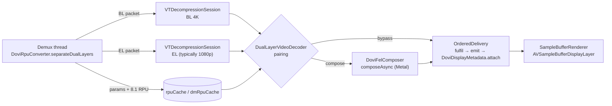

# Dolby Vision Profile 7 FEL

How AetherEngine plays a Profile 7 dual-layer source (base layer + enhancement layer + RPU) as real
Dolby Vision, what has been proven on device, and the design that does it with bounded CPU, GPU and
memory while staying correct.

**Optional component.** The route and the composer are compiled only with the `DualLayerDolbyVision`
package trait, which is off by default ([README › Optional components](../README.md#optional-components)).
Built without it, `preferDualLayerDolbyVision` is accepted and changes nothing: the route decision
reports `not taken (built without the DualLayerDolbyVision trait)` and every Profile 7 source takes the
native route. Everything below describes a build with the trait; `aetherctl play --fel`, `--cycle-el`,
`--dv-pin`, `aetherctl feltest` and the DEBUG pin test (`armDolbyVisionPinTest`) need it too, and the
pulse probe links the engine with it through `Probes/DolbyVisionPulse/Device/PulseEngine`.

**Platforms.** Nothing in the route or the composer is tvOS-specific: the two VideoToolbox decoders and
the Metal kernels are the same on iOS, iPadOS and macOS, the route has no platform gate, and
`aetherctl play --fel --surface` runs it on a Mac. What is measured per platform is the display half:
that the system reads the per-frame Profile 8.1 attachment and applies Dolby Vision display management
(§4.1) is established on tvOS only. On iOS, iPadOS and macOS the composed picture is correct; how the
system presents its attached metadata there has not been measured.

This is the design document for the feature. User-facing behaviour lives in [formats.md](formats.md#dolby-vision-signaling), options in
[api.md](api.md), tools in [cli.md](cli.md).

Reference device for every measurement below: Apple TV 4K (2nd generation, A12, 3 GB RAM), tvOS 27.0,
HDMI to an LG OLED, 23.976 fps UHD Blu-ray remuxes.

- [1. What is being played](#1-what-is-being-played)
- [2. Output contract](#2-output-contract)
- [3. Current implementation](#3-current-implementation)
- [4. Evidence](#4-evidence)
- [5. Design](#5-design)
- [6. Verification](#6-verification)
- [7. Document map](#7-document-map)

---

## 1. What is being played

A Profile 7 access unit carries three things:

| Part | Carriage | Content |
|---|---|---|
| Base layer (BL) | ordinary HEVC NAL units | 3840×2160 HEVC Main 10, BT.2020 PQ, a complete HDR10 picture on its own |
| Enhancement layer (EL) | `unspec63` NAL units (`0x7E 0x01` + an embedded HEVC NAL) | 1920×1080 HEVC Main 10, its own VPS / SPS / PPS |
| RPU | one `unspec62` NAL unit (`0x7C 0x01`) | per-component reshaping curves (polynomial or MMR pieces), NLQ parameters for the residual, and display-management metadata (L1, L2, L5, L8, L9, L11) |

The RPU header says what the EL is for. **MEL** (minimal enhancement layer, `el_type == "MEL"`)
carries no residual: the picture is the reshaped base layer. **FEL** (full enhancement layer) adds a
residual that restores detail and precision the 10-bit base encode lost. `disable_residual_flag` can
switch the residual off for an individual RPU.

Apple platforms decode Profile 5, 8.1 and 8.4 natively and have no Profile 7 dual-layer decoder. That
leaves two ways to play Profile 7:

1. **Convert to single-layer 8.1** on the native path: rewrite each RPU with libdovi mode 2, drop the
   EL. The conversion is lossless for MEL and loses the residual for FEL. Where the display takes
   Dolby Vision that is what plays; where it does not, the native route plays the HDR10 base layer. See `DoviRpuConverter.convertPacketToProfile81`.
2. **Compose BL + EL + RPU ourselves** and present the result with its Dolby Vision metadata. That is
   the subject of this document.

## 2. Output contract

What a composed frame handed to the display layer must be:

- **Pixels.** `kCVPixelFormatType_420YpCbCr10BiPlanarVideoRange` (P010), BT.2020 primaries, PQ
  transfer, colour attachments copied from the base layer. Reconstruction runs at 12-bit precision
  (reshaped base plus inverse-NLQ residual); an ordered 8×8 Bayer dither, inverted on odd frames and
  phase-offset between Cb and Cr, takes it to 10 bits. Luma is clamped to 64–940, chroma to 64–960.
- **Metadata, on every frame.**

  | Attachment | Value |
  |---|---|
  | `DolbyVisionRPUData` | the RPU converted to Profile 8.1 (`dovi_convert_rpu_with_mode(rpu, 2)`), as the `unspec62` NAL **without** its 2-byte header, emulation-prevention bytes kept; a `CFData` |
  | `DolbyCompatibilityID` | the **`CFString` `"1"`**, never a number |

  A frame with no RPU has both attachments removed, because output buffers are recycled from pools
  and would otherwise carry a previous frame's trims.
- **Why Profile 8.1 metadata.** The composed picture is YCbCr PQ over an HDR10-compatible signal, which
  is exactly what a Profile 8.1 RPU describes. Mode 2 keeps L1 / L2 / L5 / L8 / L9 / L11 intact and makes
  the reshaping identity, which is correct because the composer has already applied the real curves.
  Profile 5 (IPT-PQ-c2) would require re-deriving the reshaping for a different colour space.
- **Who consumes it.** `HDRProcessing.framework` inside **backboardd**, on CoreAnimation's external
  display thread, on every vsync (§4.1). Nothing in the app's own process reads it, so no in-process
  instrument can observe consumption.

## 3. Current implementation



| Stage | Code | Thread | What happens per frame |
|---|---|---|---|
| Routing | `VideoRoutingPolicy.requiresSoftwarePath`, `SoftwarePlaybackHost` decoder selection | load | Profile 7 + `preferDualLayerDolbyVision` + `dolbyVisionHandling` `.automatic` + VOD seekable source + hardware HEVC decode + `el_type` FEL + inside the real-time budget (§5.2) → software host, which picks `DualLayerVideoDecoder` (§5.2) |
| Split | `DoviRpuConverter.separateDualLayers` | demux | RPU parsed into composer parameters and converted to an 8.1 NAL; EL NAL units copied into a new `AVPacket`; the BL packet goes to VideoToolbox untouched (it skips the `unspec` NAL units itself) |
| Align | `DualLayerPictureAlignment.enhancementPTS` | demux, under the decoder's lock | each layer's display slot from its POC (`HEVCPictureOrderCount`); the EL packet takes the PTS of the BL picture in the same slot, so pairing by time pairs by picture order when the layers' GOPs differ. A layer whose sequence cannot be trusted (leading pictures of the opener, or more than 16 slots off its unit, or a seek before its next IRAP) keeps its access unit's PTS |
| Decode | two `HardwareVideoDecoder`s | VideoToolbox output threads | asynchronous decode with temporal processing, P010 IOSurface buffers in decode order (the renderer's 4-frame reorder buffer restores display order, as for any VideoToolbox HEVC stream) |
| Pair | `DualLayerVideoDecoder.handleBaseLayerFrame` / `handleEnhancementLayerFrame` | VideoToolbox output threads, under the decoder's recursive lock | match the other layer by 90 kHz canonical PTS within ±300 ticks; a base-layer frame takes its ticket at arrival and is bypassed under it once K = 3 newer base-layer frames have arrived; waiting enhancement frames capped at 10; side data in a 32-entry ring; `hdr10Data` and the display-metadata NAL are resolved once here and travel with the ticket |
| Compose | `DoviFelComposer.composeAsync` | caller, then Metal | wait for one of 3 in-flight slots, rent a P010 buffer (§5.6), copy colour attachments from the base layer, bind 6 texture-cache textures, serialize the parameter block, encode luma and chroma kernels in one concurrent encoder, commit |
| Deliver | Metal completion handler → composer's `deliveryQueue` (composed frames) or the pairing call directly (a bypass) → `OrderedDelivery.fulfil` → `emit` | Metal's completion queue hands off immediately to the composer's own `.userInteractive` queue (§4.3's firewall, not an ordering mechanism), or the pairing thread for a bypass, then `OrderedDelivery`'s own `.userInteractive` queue — never the decoder lock | release the GPU slot inline, nothing else, on Metal's queue; everything else (error logging, GPU-time accounting, `completion`) hops off it first. Either path hands the frame to `OrderedDelivery` (§5.7): one serial queue orders composed and bypassed frames alike regardless of which queue called `fulfil`, drops anything tagged with an epoch a flush/close has since retired, and calls `onFrame` (renderer enqueue) with no decoder lock held |

A frame bypasses composition, and goes out as its base layer with its own DV metadata, when the
stream is not FEL, when MEL was detected, when no RPU parameters exist for its PTS, or when
composition fails.

**Kernels** (`DoviShaderSource.swift`). Luma: base code → piece selection → polynomial (evaluated in
normalized float) or MMR when the luma curve uses MMR → plus the inverse-NLQ residual of the
enhancement-layer luma, upsampled with one hardware-bilinear fetch →
12-bit clamp → dither → 10-bit. Chroma: base chroma plus the base luma at the chroma site ([1 2 1] around
the even column in each of the cell's two rows, rows averaged; DoViBaker's MMR input) → MMR → plus the residual from the enhancement chroma, upsampled with one
hardware-bilinear fetch co-sited with the top-left luma sample (DoViBaker's phase) → dither.

**Parameter ABI.** `DoviShaderSource.sharedStructs` on the GPU side, `DoviMetalParams.serialize` on
the Swift side. `DoviLayoutProbeTests` has the GPU read every sub-block back at the offset Swift wrote
it to; `DoviShaderSyncTests` pins the serialized size and that every kernel is present.

### 3.1 Audio

Known trade-off of the route, following the maintainer's request to document it rather than work around it.
The dual-layer route runs on `SoftwarePlaybackHost`, so its audio is the host's own `AudioDecoder` (FFmpeg
decode to PCM, played through the sample-buffer audio renderer) and never AVPlayer. On tvOS only AVPlayer
emits Dolby Atmos objects, and the platform does not pass a bitstream through. An E-AC-3 (JOC) track
therefore plays as its channel-bed core (5.1 or 7.1), without the Atmos objects; on the native route the
same track is handed to AVPlayer unchanged. TrueHD behaves as on the native route, which decodes it too and
loses the objects either way. Hosts that want E-AC-3 Atmos on a Profile 7 FEL title leave
`preferDualLayerDolbyVision` off for it. `DualLayerRouteAudioTests` pins the routing half of this.

## 4. Evidence

### 4.1 tvOS consumes the attachment, in backboardd

Two device runs were killed with `SIGKILL` about eleven composed frames in. The app log showed nothing
wrong except `Connection interrupted` and `invalid destination port` from CoreAnimation, which means
the render server died first. The paired Apple TV's own crash reports held two `backboardd-*.ips`
files timed to the runs, and no `JetsamEvent`, which rules out memory pressure. Both had this stack:

```
Exception: EXC_CRASH (SIGABRT), -[__NSCFNumber length]: unrecognized selector
Thread:    com.apple.coreanimation.display.external-0
  CFStringGetIntValue
  -[HDRProcessor applyDoVi81PolicyWithInput:WithRPU:]
  -[HDRProcessor processFrameInternalWithLayer0:layer1:outout:metadata:commandbuffer:…]
  CA::HDRProcessorInternal::tonemap_surface_internal(__IOSurface*, …, __CFData const*, …)
  CA::HDRProcessorInternal::create_surface_with_forward_dm
  CA::Render::ImageQueue::forward_dm
  CA::WindowServer::IOMFBServer::vsync_callback
```

That is the proof of consumption: on the vsync callback, CoreAnimation pulls display management off
our IOSurface and applies Dolby Vision 8.1 policy with our RPU. It is also the bug: the policy parses
`DolbyCompatibilityID` with `CFStringGetIntValue`, and we had attached a `CFNumber`. Decoding a
Profile 8.1 asset through `AVAssetReader` and printing the CF type of VideoToolbox's own attachments
confirmed the fix:

| Attachment | Class | CF type | Value |
|---|---|---|---|
| `DolbyCompatibilityID` | `NSTaggedPointerString` | `CFString` | `"1"` |
| `DolbyVisionRPUData` | `__NSCFData` | `CFData` | 188 / 189 bytes |

The payload form was established the same way: VideoToolbox's `DolbyVisionRPUData` matches the
bitstream's `unspec62` NAL byte for byte once the 2-byte header is removed and the emulation-prevention
bytes are left in; the EPB-stripped RBSP is 176 bytes and does not match.

Two consequences carry forward. A malformed attachment crashes the render server and looks, from
inside the app, like an unexplained kill; suspect the attachment before memory. And the device crash
reporter (`devicectl … --domain-type systemCrashLogs`) is the instrument for anything that happens
out of process.

### 4.2 Throughput: the composer must not block decode

Playback first ran with `compose` ending in `waitUntilCompleted()` under the decoder lock. The deficit
was steady, not a hitch:

| | Blocking compose | `composeAsync` + one encoder |
|---|---|---|
| Delivered rate | 21.4–22.0 fps | real time, ~26.6 fps while catching up after a seek |
| Video lead | slipping 0.09 s per second | flat at about +0.5 s |
| Display drops | +3…+7 every second | flat after seek settling |
| GPU time per frame | 28 ms end to end, serialized | 14.3 → 12.9 ms, off-thread |

Most of the original 28 ms was the wait and the CPU-side setup, not GPU work: the A12 has about 3×
headroom against the 41.7 ms budget at 23.976 fps. The two serial compute encoders were merged into
one concurrent encoder because the luma and chroma kernels never read each other's output; the
bit-exactness suites passing unchanged is what proves that moved no pixels.

### 4.3 The completion-handler deadlock

Metal runs every `addCompletedHandler` block for a command queue on one serial queue. The first async
version delivered from inside that handler, which took the decoder lock, while the caller held the
same lock waiting in `inFlight.wait()` for the signal that only a later handler could send. Playback
stopped after about ten seconds with the session still reporting healthy. The fix, and a rule for any
future change: **release the slot inline in Metal's handler and do nothing there that can block; hop
to another queue for everything else.** `DoviComposeAsyncTests.doesNotDeadlockAgainstTheCallersLock`
reproduces the exact lock shape; against the old handler it hung past a 300 s timeout.

### 4.4 Earlier fixes worth remembering

| Symptom | Cause | Rule |
|---|---|---|
| Metal validation abort binding textures | integer kernel access on a Unorm texture | bind BL and output planes as `r16Uint` / `rg16Uint`, EL planes as `r16Unorm` / `rg16Unorm` so they can be filtered |
| Black picture with `COMPOSE SUCCESS` on every frame | 10-bit prediction treated as 12-bit | keep the whole reconstruction in one declared precision |
| Green / purple picture | chroma curves with fewer than 2 pivots returned 0 | an absent curve is identity, not zero |
| GPU reading freed memory | `CVMetalTexture` wrappers released before completion | keep textures *and* their source buffers alive until the command buffer retires (`ComposedFrame`) |
| Layers never pairing | container vs decoder timestamp scales | canonicalize to 90 kHz and match within ±300 ticks |
| EL decoder never opening | EL VPS / SPS / PPS split across packets | accumulate parameter sets across packets |
| Profile 7 plays as plain HDR10 | the container carries no `dvcC` record, so the load never sees a Profile 7 (routing and the `el_type` probe both start from the record) | none: the file plays as its HEVC base layer, the `unspec62` / `unspec63` NAL units ignored. `DolbyVisionRecordAudit.addRecordIfProfile5` repairs a recordless Profile 5 only; for Profile 7 the fix is a remux that writes the record |

### 4.5 Consumption test assets

`aetherctl dvsurvey` ranks frames by L1 distance from the title's median so that the pin test can
pin a frame whose metadata is a large lie. On the three local test clips: a CMv4.0 4000-nit clip pins
frame 247 (`max_pq` 4095 against a median of 2081, distance 3876, the best asset); a scene clip gives
distance 1391, usable; a credits clip has static L1 (distance 0) and is correctly rejected as `WEAK`.

The consumption question, whether the panel uses the RPU the engine attaches rather than only
switching into a Dolby Vision mode, is answered by a pulse test that anyone with an Apple TV, a
television and a phone can repeat: clips whose pixels are constant while only the RPU (or the
enhancement-layer residual) switches, played through AVPlayer, VideoToolbox and the FEL route, and
filmed. Clip generator, device host, harness scripts and analysis are in
[`Probes/DolbyVisionPulse`](../Probes/DolbyVisionPulse/README.md).

### 4.6 Caveat on the numbers

Every device figure above came from DEBUG builds: `-Onone`, with the HDMI probe retrying and the
memory watermark sampling on every emitted frame. They show the direction and the GPU cost; CPU and
memory should be re-measured on a release build. Footprint went from a flat ~390 MB to a plateau of
~705 MB with the async pipeline; §5.10 accounts for the pipeline's own share.

---

## 5. Design

VideoToolbox decodes both layers, one concurrent Metal encoder composes them, each frame carries the
Profile 8.1 attachment, delivery is ordered by ticket, and the GPU slot is released inline. The
sections below are the rules that keep per-frame work and shared mutable state to a minimum.

### 5.1 Principles

1. **Decide once per stream, not per frame.** FEL vs MEL is a property of the encode; routing and
   decoder setup decide it, and no callback changes it.
2. **Touch each byte once.** One libdovi parse per RPU, no copy of the base-layer access unit.
3. **Nothing blocks while holding a lock, and every piece of state has one owner.**
4. **Every frame has a bounded lifetime.** Bounded wait for its partner, bounded queues, bounded GPU
   work in flight, and nothing from before a flush survives it.
5. **Per-frame work writes no log lines at the default level.** Counters feed a 1 Hz summary, which is
   a `.verbose` line (§5.11).

### 5.2 Routing

The load probes the first RPU's `el_type` (`DolbyVisionRecordAudit.probeEnhancementLayerType`) and
passes it into `VideoRoutingPolicy`:

| Source | `dolbyVisionHandling` | `preferDualLayerDolbyVision` | Device | Route |
|---|---|---|---|---|
| P7, `el_type` FEL | `.automatic` | true (opt-in; the default is false) | VideoToolbox HEVC hardware + Metal | software host, `DualLayerVideoDecoder` |
| P7, `el_type` FEL | `.automatic` | false (the default), a build without the `DualLayerDolbyVision` trait, or no VideoToolbox HEVC hardware decode | any | native (8.1 conversion where the display takes Dolby Vision, otherwise the HDR10 base layer) |
| P7, `el_type` MEL | `.automatic` | any | — | native (as above; the conversion loses nothing for MEL) |
| P7, any | `.baseLayerOnly` | any | — | HDR10 base layer |

The software host then instantiates `DualLayerVideoDecoder` only for the first row; a Profile 7 forced
onto the software path by any other combination gets a plain `HardwareVideoDecoder` for the base layer.

### 5.2.1 The capability gate and its diagnostic line

The route is FEL only and capability gated (`DualLayerRouteDecision`, pure and unit-tested). Everything
else keeps the native route, which plays single-layer 8.1 where the display takes Dolby Vision and the
HDR10 base layer where it does not: the preference is off, the build lacks the `DualLayerDolbyVision` trait, `dolbyVisionHandling` is not `.automatic`, a
live or non-seekable source, a box with no hardware HEVC decoder for the stream, a MEL source (nothing
to compose), an enhancement layer the probe could not classify, a base layer of unknown size, and a
stream the box could not decode twice in real time. The checks run in that order (the code's order:
preference, trait, handling, live/seekable, hardware, `el_type`, geometry, budget). The `el_type` probe (a packet
scan and a seek) runs once nothing up to and including the hardware check has ruled the route out, so it
also runs for a stream that the geometry or the budget then refuses: the MEL / unknown answer outranks
the size reasons in the log line, and that precedence needs the probe's answer.

The real-time budget is a pixel rate, base layer plus enhancement layer, from the stream's width, height
and frame rate: `DualLayerRouteDecision.maximumPixelsPerSecond`, 311.04 Mpx/s, which is UHD
3840x2160 at 30 fps plus a 1920x1080 enhancement layer at 30 fps. The enhancement layer is taken as a
quarter of the base layer's area (what a 4K FEL disc ships), and an unknown frame rate is budgeted as 24
(the line says "assumed"). The load passes no enhancement-layer size, so it always budgets the quarter-area
layer (every retail FEL title's layout); a 1:1 enhancement layer is not detected at load. A base layer whose
width or height is unknown (not positive) is refused rather than budgeted at zero. A 24p UHD FEL master needs 80% of the budget. What is measured: the Mac soak runs in the PR
description (M2 Pro, debug `aetherctl`), and, from earlier development builds on an Apple TV 4K 2nd
generation, the composer's GPU time of 12.9-14.3 ms per frame against a 41.7 ms frame at 23.976 fps
(§4.2, a debug build and a previous iteration of the pipeline, not this stack). The 311 Mpx/s ceiling,
and 30 fps as a margin above 24p, are an assumption until the Apple TV run of this stack. UHD at 60 fps
(200%) and 8K fall back.

A Profile 7 load logs exactly one line, whichever way it goes (other sources log nothing here):

```
[AetherEngine] DV P7 dual-layer route: taken (el_type=FEL, 3840x2160@23.976, budget 80%)
[AetherEngine] DV P7 dual-layer route: not taken (el_type=MEL, nothing to compose), keeps the native route (8.1 where the display takes Dolby Vision)
[AetherEngine] DV P7 dual-layer route: not taken (preferDualLayerDolbyVision is off), keeps the native route (8.1 where the display takes Dolby Vision)
[AetherEngine] DV P7 dual-layer route: not taken (built without the DualLayerDolbyVision trait), keeps the native route (8.1 where the display takes Dolby Vision)
[AetherEngine] DV P7 dual-layer route: not taken (over the real-time budget, 3840x2160@60 needs 200% of it), keeps the native route (8.1 where the display takes Dolby Vision)
[AetherEngine] DV P7 dual-layer route: not taken (base-layer size unknown), keeps the native route (8.1 where the display takes Dolby Vision)
```

A missing Metal device does not fall back to the native route: the routing decision above has
already been made, so the software host keeps the base layer alone on a `HardwareVideoDecoder` (HDR10,
no composition). The same is true after the fact: if the compute shaders fail to compile, the decoder
stays but every frame goes out as its base layer.

### 5.2.2 The display is not consulted

The route decision does not look at the display. With `preferDualLayerDolbyVision` on and a display
that does not take Dolby Vision (an SDR or HDR10-only panel or mode), the route is still taken when
the gate above passes: the software host composes the full FEL picture and presents it with the
Profile 8.1 metadata attached (§2), and how tvOS presents that on such a display is up to the platform.
The native route, by contrast, strips the Dolby Vision for such a display (`CodecRoutePolicy`) and plays
the HDR10 base layer. A host that wants the base layer on a non-Dolby-Vision display leaves the flag off,
or sets it from what it knows of the display. The audio trade-off of §3.1 (an E-AC-3 Atmos track plays as
its channel-bed core, without the objects) applies on this route whatever the display. This is the current
behaviour, documented rather than designed; it is not changed here.

### 5.2.3 What the route gives up against the native route

The dual-layer route runs on the software host: there is no `AVPlayer` and no `AVPlayerItem`, and the
picture is drawn into an `AVSampleBufferDisplayLayer`. Everything that AVKit or the loopback HLS
server provides to the native route through the item is therefore either replaced by an engine
equivalent or absent. With `preferDualLayerDolbyVision` off none of this changes. The comparison,
checked against the code:

| Feature | Native route | Dual-layer route |
|---|---|---|
| Picture in Picture | `AVPlayer`-based: the stock `AVPlayerViewController` and a host-built `AVPictureInPictureController` both work. | No `AVPlayer`, so no stock player PiP. The engine publishes `SoftwarePiPSource` (the layer plus the transport answers for a sample-buffer PiP content source) and the host builds the `AVPictureInPictureController` around it; while PiP is active, subtitle cues are drawn into the frames by `SubtitleFrameCompositor`, which carries the pixel-buffer attachments through. Whether the PiP window presents the composed picture as Dolby Vision is not measured. |
| Scrub thumbnails | With `serveIFramePlaylist`, an `EXT-X-I-FRAME-STREAM-INF` rendition next to the master, so a stock `AVPlayerViewController` draws its own thumbnails and scans on I-frames, plus `scrubThumbnail(atSeconds:)`. | No I-frame playlist, so a stock player shows no thumbnails of its own. `scrubThumbnail(atSeconds:)` answers from the software host's retained packet cache (`servesPacketCacheStills`) and only when that cache exists: a local file is read directly and has none, so there the call returns nil. The still is the base layer decoded by libavcodec, not the composed picture. |
| Subtitles | Text tracks can be declared in the init segment and served as WebVTT renditions (`prepareNativeSubtitles`), so `AVMediaSelection`, PiP and external screens render them. | No renditions and no `AVMediaSelection`. The engine decodes the cues and publishes them; the host draws its own overlay in the app. They appear in a PiP window only through the frame compositor above, and the system caption styling does not apply. |
| AirPlay | `AVPlayer` hands the receiver the stream (the engine serves the loopback over the LAN address for it). | The layer draws on the device and only the audio renderer follows the route, so a wireless receiver plays sound only. The engine publishes `airPlayPictureStaysLocal` (iOS) so a host can say so. Not applicable where the device is itself the receiver. |

A host that needs any of these for a Profile 7 title leaves the flag off for it, as for the Atmos
trade-off of §3.1.

### 5.3 Packet split

One walk over the access unit's NAL units, on the demux thread:

- **RPU:** `dovi_parse_unspec62_nalu` once. From that handle read the header (`disable_residual_flag`),
  the data mapping (into `DoviMetalParams`), then convert with mode 2 and write the 8.1 NAL. Strip its
  header once into the attachment `Data`.
- **EL:** copy the embedded NAL units into the EL packet (one 1080p copy, unavoidable because
  VideoToolbox needs a standalone access unit).
- **BL:** hand the packet to VideoToolbox **untouched**. The format description is built from the base
  layer's parameter sets with no `dvcC`, so `unspec62` and `unspec63` are unknown NAL types it skips.
  The rebuild stays only in `convertPacketToProfile81`, where the container does declare Dolby Vision.

Side data goes into a **`FrameSideDataRing`** keyed by canonical PTS: `{ params, dvPayload, flags }`,
fixed capacity 32 (reorder depth plus maximum layer skew with margin). Insert overwrites the oldest,
lookup scans at most 32 entries for the nearest key within ±300 ticks. No sorting, no dictionaries.

### 5.4 Decode

Two `HardwareVideoDecoder`s. `HardwareVideoDecoder.decode` wraps the packet's memory with
`CMBlockBufferCreateWithMemoryBlock` and a custom block source that holds an `av_buffer_ref` of
`packet.buf` and unrefs it in `FreeBlock`, so VideoToolbox can retain the data past the call without a
copy. When `packet.buf` is nil it falls back to the copy. This benefits every HEVC source on the
software path, not just FEL.

### 5.5 Pairing

Pairing lives in `DualLayerVideoDecoder.handleBaseLayerFrame` / `handleEnhancementLayerFrame`, under
the decoder's lock, and each call is O(K):

- A **base-layer frame takes its ticket when it arrives.** VideoToolbox outputs in decode order, so
  ticket order is decode order, whatever happens to the frame later. Display order is restored
  downstream, by the renderer's reorder buffer (4 frames, the same depth as a single-layer hardware
  decode; `DoviFelRealFileTests.reconstructsAndOrders` replays that rule on the real files).
- If its enhancement layer is already waiting (within ±300 ticks), the pair is composed. Otherwise it
  waits.
- **A waiting base layer is bypassed, under its own ticket, once K newer base-layer frames have
  arrived.** K (`maxLayerSkewFrames`) is the maximum layer skew, 3; the summary line reports the
  observed skew (§5.11). A lost enhancement frame costs K frames of delay and never reorders output.
- An enhancement frame whose base layer has already gone out (its key matches one of the last 64
  settled base-layer keys) is dropped on arrival. At most 10 enhancement frames wait.
- A frame's side data is looked up once, when its base layer arrives, and travels with the ticket;
  delivery never touches a shared cache.
- The `disable_residual_flag` of an individual frame becomes a kernel flag
  (`DoviComposerFlags.disableResidual`); it never changes the stream classification.

### 5.6 Compose

- **Acquire the in-flight slot outside the decoder lock**, on the VideoToolbox output thread that
  produced the `compose` action, then encode and commit. Blocking that thread is the intended
  backpressure: VideoToolbox stops emitting, the display layer stops draining, and the demux loop's
  existing `mayEnqueueVideoFrame` gate (the renderer's queue readiness plus the look-ahead bound) holds.
- **Parameters** are written straight into one of `maxFramesInFlight` preallocated shared
  `MTLBuffer`s (`DoviMetalParams.serialize(into:)`), bound with `setBuffer` for both kernels. No `Data`,
  no heap arrays per frame.
- **Output pool** gets `kCVPixelBufferPoolAllocationThresholdKey` = the renderer's FEL look-ahead (9)
  + the frame on screen and the one the display layer retains (2) + the in-flight slots (3) + 1, so 15.
  A refused buffer would put a base-layer frame on screen, a visible brightness step, so past the
  threshold a burst draws on a reserve of 3 more. Only with the reserve spent does the composer wait,
  for at most about 36 ms (a 300 ms wait stalled the VideoToolbox callback and starved audio into
  rebuffers on device), and then the frame bypasses instead of growing the pool.
- **Texture cache** is flushed from the 1 Hz tick, which releases textures for buffers no longer in use.
- **Colour attachments** are copied from the base layer when encoding, on the calling thread, not on
  Metal's completion queue.
- **Pipelines** are compiled once per process, lazily on first composition (a shared `MTLLibrary` and
  pipeline states), so a MEL or bypassed stream never compiles and a second decoder instance does not
  recompile.
- **Kernels:** a per-frame 1024-entry luma prediction table replaces piece selection and polynomial
  evaluation per pixel whenever luma is polynomial (it is a pure function of the 10-bit base code);
  residual evaluation is skipped per component when that component's NLQ is inactive; threadgroup sizes
  come from `threadExecutionWidth`. Every one of these keeps `DoviGpuCurveSweepTests` bit-exact.

### 5.7 Delivery

An `OrderedDelivery` object owned by the decoder, not the composer:

```swift
final class OrderedDelivery {
    private let queue = DispatchQueue(label: "de.superuser404.dovi.delivery", qos: .userInteractive)
    // Confined to `queue`: no lock.
    private var epoch: UInt64 = 0
    private var nextToEmit: UInt64 = 0
    private var pending: [UInt64: DeliveredFrame] = [:]

    func fulfil(ticket: UInt64, epoch: UInt64, _ frame: DeliveredFrame)  // queue.async
    func resetAsync(epoch: UInt64, nextTicket: UInt64)                    // queue.async, callable under a lock
    func barrier()                                                        // queue.sync, never under a lock
    func reset(epoch: UInt64, nextTicket: UInt64)                         // resetAsync + barrier
}
```

- **Every** outgoing frame goes through `fulfil`: composed frames from the composer's relay queue
  (after `slot.signal()`, see below), bypassed frames straight from the pairing call. One serial queue orders
  both, so no lock and no recursive re-entry are needed.
- **The queue owns its state.** `emit`, which attaches the DV metadata and calls `onFrame`, runs on it
  with no decoder lock held, so the renderer's own lock is never nested inside ours.
- **QoS `.userInteractive`.** The work per frame is O(1) (two attachments and an enqueue), it is bound
  by the frame rate, and it decides what is on screen next, which is what that class is for. A queue
  created with only a label has unspecified QoS and inherits whatever the submitting Metal completion
  thread carries, so presentation can wait behind default- or utility-class work. Because the work is
  tiny it cannot starve the UI; if a trace ever shows contention on tvOS, `.userInitiated` is the
  fallback.
- **Epochs instead of moving the line under a lock.** A ticket carries the epoch it was issued in;
  a stale one is dropped when it reaches the head of the queue. `barrier()` runs with `queue.sync`,
  which waits for any delivery in progress, so nothing from an old epoch can reach `onFrame` after
  `flush()` returns. It asserts `dispatchPrecondition(condition: .notOnQueue(queue))`: a host must
  never flush from inside `onFrame`.
- **Stall guard.** If more than `maxFramesInFlight + K + 2` frames are pending behind a missing
  ticket, skip the missing ticket and log once. A lost ticket must cost one frame, not the session.
- **No `.global()` fallback.** The completion handler captures the delivery object strongly; a
  completion that outlives the decoder delivers into an epoch that no longer exists and is dropped.

**The composer keeps its own relay queue.** A composed frame's completion is not handed straight to
`OrderedDelivery.fulfil` from Metal's completion handler. `DoviFelComposer` keeps a small serial `deliveryQueue` (`qos: .userInteractive`,
captured as a plain value, no `.global()` fallback) that every composed frame's completion hops through
first; only there does it call `completion`, which is `fulfil` in production. §4.3 requires exactly this
shape — "release the slot inline in Metal's handler and do nothing there that can block; hop to another
queue for everything else" — and `DoviComposeAsyncTests.doesNotDeadlockAgainstTheCallersLock` reproduces
the deadlock removing the hop would reopen: a `completion` that blocks on the caller's lock, run directly
on Metal's shared completion queue, stalls every later handler too, including the `inFlight.signal()` a
different, currently-blocked caller needs. `deliveryQueue` carries no ordering responsibility of its
own — `OrderedDelivery` reorders every frame by ticket regardless of which queue or thread calls
`fulfil`, so a bypass arriving directly from a VideoToolbox thread and a composition arriving via this
relay hop are indistinguishable once they reach it. This is a deliberate queue hop, not a second
ordering mechanism. An `os_signpost` event in the Metal completion handler
(`DoviFelComposer`'s "Compose" signpost) marks the instant Metal invoked it, separately from the
interval's `.end` (which only fires after this hop), so the hop's own latency is visible in Instruments
rather than folded into either "Compose" or "Delivery".

### 5.8 Flush and close

Order matters because `HardwareVideoDecoder.flush` waits for frames VideoToolbox still owes, and those
arrive through the normal callbacks:

1. Under the lock: bump the feed epoch (so `decode(packet:epoch:)` refuses packets from before the
   seek), raise `draining`, take `nextTicket`, and enqueue `delivery.resetAsync(epoch:nextTicket:)` —
   from inside this same critical section, not after. Then, still outside the lock but before draining,
   call `delivery.barrier()` to wait for that reset to actually run.
2. Flush both `HardwareVideoDecoder`s. Their pending frames land in pairing, in the old state, but
   `draining` (still up) drops them before they can take a ticket, and any composition already in
   flight before this call is dropped by the epoch check the instant it reaches `fulfil`.
3. Under the lock, lower `draining` and reset pairing and the side-data ring.
4. Flush the composer's texture cache.

The epoch is retired in step 1, before draining, and not after the drain. Retiring it after the
drain, with a plain `delivery.reset` once the lock was released, left a gap: a VideoToolbox callback
landing between that `unlock()` and the `reset` could take a new-epoch ticket and reach `fulfil` before
`reset` had run, so the ticket was dropped as still-old-epoch and `reset` then fast-forwarded past it,
stalling every following frame until the stall guard skipped the hole. Splitting the reset into a
non-blocking enqueue (`resetAsync`, called while still holding the lock) and a wait (`barrier`, called
after releasing it) closes that gap: `draining` cannot go false, so no new ticket can be issued, until
`barrier()` has confirmed the new epoch is installed. It also keeps a composition that was already in
flight before the flush from reaching `onFrame` while `HardwareVideoDecoder.flush()` is still draining.
`OrderedDeliveryTests.newEpochTicketFulfilledBeforeResetIsDeliveredIsNotLost` and
`DualLayerVideoDecoderTests.flushDoesNotLosePostFlushTicketInTheUnlockToBarrierGap` drive that window
directly.

`close()` follows the same shape (bump epoch, capture `nextTicket`, `resetAsync` — all inside one
critical section that also sets `isClosed` — then `barrier()` after unlocking), then clears `onFrame`,
swaps the enhancement decoder out under the lock and closes it outside, and resets the stream
classification so the object cannot leak one stream's decisions into the next. A closed decoder refuses
`open` (single use) rather than being half reusable. A concurrent `flush()`/`flush()` or
`flush()`/`close()` is serialized by the decoder's lock the same way either order: `_feedEpoch` and
`deliveryNextTicket` only ever move forward under it, and the lock also fixes the order the two calls'
`resetAsync`s land in `delivery`'s own queue, so whichever lands later always carries the larger epoch —
neither the epoch nor `nextToEmit` can move backwards.

### 5.9 Threading model

| Thread | Does | Holds | May block on |
|---|---|---|---|
| Demux | NAL split, one libdovi parse, side-data ring insert, VideoToolbox submit | decoder lock, O(1) | nothing |
| VideoToolbox output (BL, EL) | pairing; for `compose`, slot acquisition then encode and commit | decoder lock for the pairing call only | a GPU slot, with no lock held |
| Metal completion | `slot.signal()`, GPU time sample, hop to the composer's relay queue | none | never |
| Composer relay queue (`deliveryQueue`, `.userInteractive`) | `completion` (= `delivery.fulfil` in production) | none | nothing (a slow `completion` queues up behind itself and never blocks Metal; see I7 in §5.12) |
| Delivery queue (`.userInteractive`) | ordering, epoch check, DV attachment, `onFrame` | none of ours | the renderer's enqueue |
| Host (seek, stop) | `flush()`, `close()` | decoder lock briefly; `delivery.barrier()` outside it | VideoToolbox drain, and whatever `onFrame` is doing when `barrier()` catches up to it |

### 5.10 Budgets

Memory held by the pipeline (4K P010 = 24.9 MB, 1080p P010 = 6.2 MB; VideoToolbox's own reference
pictures and the display layer's queue are extra):

| Holder | Bound |
|---|---|
| Base-layer frames waiting for their EL | K = 3 → 75 MB |
| Enhancement-layer frames waiting | 10 → 62 MB |
| Composed output buffers (in flight, pending, idle in pool) | allocation threshold 15 + reserve 3 → 448 MB, the reserve freed after a second unused |

CPU per composed frame:

| Work | Cost |
|---|---|
| libdovi RPU parses | 1 |
| Base-layer access-unit copies | 0 (`CustomBlockSource` hands VideoToolbox the packet's own buffer) |
| Enhancement-layer copies | 1 (extraction into a standalone access unit) |
| Log lines at the default level | 0 per frame; a 1 Hz summary at `.verbose` instead (§5.11) |
| Parameter upload | written into a preallocated `MTLBuffer` |
| Side-data lookup | the 32-entry ring, no sorting |
| Shader compilation | once per process, lazily |

GPU: 12.9–14.3 ms per frame measured on the A12 (§4.2), against a 41.7 ms budget at 23.976 fps. A
59.94 fps source (16.7 ms budget) has far less headroom.

### 5.11 Observability

One `[DualLayerVideoDecoder] summary` line per second while composing: frames composed, compose
failures, bypassed without EL, bypassed without RPU, stale enhancement frames dropped, maximum
observed layer skew in frames, peak GPU slots in use, output pool buffers allocated, delivery pending
peak, mean GPU ms. `[DoviFelComposer] gpu … ms/frame` is the same kind of line, once per 120 composed
frames. Both are `.verbose`: they go to OSLog's debug level and never reach the host handler, so they
cost nothing unless the category's debug level is on:

```
log stream --level debug --predicate 'subsystem == "de.superuser404.AetherEngine" && category == "sw.playback"'
```

The exception is a summary whose second counted a compose failure, which goes out at the default level
so the failure is visible without that. `os_signpost` intervals around compose and delivery make the
pipeline readable in Instruments. Nothing else logs per frame; anything genuinely per-frame for
debugging, such as the pairing, queueing and bypass traces, uses `EngineLog` level `.verbose` too.

### 5.12 Invariants and the tests that hold them

| # | Invariant | Test |
|---|---|---|
| I1 | Every base-layer frame is delivered exactly once, or dropped by a flush or close | `DualLayerVideoDecoderTests.singleLayerBypassesInOrder`, `orphanedBaseLayerIsEventuallyDelivered` |
| I2 | Delivery order is base-layer decode order within an epoch | `asyncCompositionKeepsItsPlace`; `prunedFrameDoesNotOvertakeNewerFrames` |
| I3 | Nothing from before `flush()` is delivered after it returns; nothing after `close()` returns | `flushRetiresOutstandingFrames`, `closeStopsDelivery`, `flushFromAnotherThreadInATightLoopKeepsInvariantI3` (200 concurrent flushes racing delivery, with a per-flush "started tag vs. returned count" detector), `flushDoesNotLosePostFlushTicketInTheUnlockToBarrierGap`, `flushDropsFramesEmittedFromInsideFlush`, and `OrderedDeliveryTests.newEpochTicketFulfilledBeforeResetIsDeliveredIsNotLost` |
| I4 | A frame carries its own RPU; a frame without one carries none; the compatibility ID is a string | `displayMetadataTravelsWithItsFrame` |
| I5 | Composition never invents coefficients | `missingRPUBypassesToBaseLayer` |
| I6 | Layers pair within ±300 ticks and not beyond | `jitterTolerance` |
| I7 | Held frames are bounded: waiting EL, waiting BL, GPU in flight | `orphanedEnhancementLayersAreBounded`, `lostEnhancementLayerDelaysBaseLayerByAtMostKFrames`; `DoviComposeAsyncTests.completionsAreExactlyOnceAndBounded`. **Not bounded on its own: the delivery queue.** A slow `onFrame` does not throttle pairing (a composed frame's GPU slot is released before delivery), so nothing bounds the backlog in `OrderedDelivery` itself. The demux thread's `mayEnqueueVideoFrame` gate limits how fast new packets arrive, which limits the backlog only indirectly; `flush()`'s `barrier()` waits for the queue to empty but does not cap it. |
| I8 | No lock is held across a blocking wait or a host callback | `DualLayerVideoDecoderTests.slowOnFrameDoesNotBlockDecoderOperations` (a blocked `onFrame` never stalls concurrent decoder work); `DualLayerGpuSlotWaitTests` for the GPU slot wait |
| I9 | Stream classification changes only at open, flush or close | `DualLayerStreamClassificationTests` |

---

## 6. Verification

**Unit tests.** The GPU suites need a Metal device and skip without one.

```bash
swift test --filter "Dovi|DualLayer|OrderedDelivery|FrameSideDataRing"
```

| Suite | Covers |
|---|---|
| `DualLayerVideoDecoderTests` | pairing in both arrival orders, jitter tolerance, missing-RPU bypass, ordered delivery across async composition, DV metadata per frame, flush and close, bounded queues |
| `DoviComposeAsyncTests` | async output identical to blocking compose, exactly-once completion, bounded in-flight work, the lock re-entrancy deadlock |
| `DoviGpuCurveSweepTests` | bit-exact identity round trip and curve sweeps on the GPU |
| `DoviFelMathTests` | NLQ, pivots, MMR, polynomial precision, a real RPU composed on the GPU |
| `DoviDitherTests` | dither pattern, Cb / Cr phase offset, zero mean bias |
| `DoviLayoutProbeTests` | GPU reads every parameter sub-block at the Swift offset |
| `DoviShaderSyncTests` | every kernel present, parameter block size, one pipeline per process |
| `DoviRpuConverterTests` | NAL surgery, framing, degradation to HDR10 |

**CLI** ([cli.md](cli.md)): `aetherctl feltest` (pixel and metadata verdicts, exit codes 0–5),
`dvsurvey`, `dovitest`, and `play --cycle-el` to flip the residual on a timer.

**Device.** With `DEVELOPER_DIR` pointing at an Xcode that has `devicectl`:

```bash
# the host app's own log file, if it writes one (a sink on `EngineLog.handler`)
xcrun devicectl device copy from --device <name> --domain-type appDataContainer \
  --domain-identifier <bundle id> --source <host log file> --destination ./device.log
# crash reports, including backboardd's
xcrun devicectl device info files --device <name> --domain-type systemCrashLogs --no-recurse
# live Dolby Vision diagnostics (text logs; the signposts are categories dovi.compose and dovi.delivery)
log stream --predicate 'subsystem == "de.superuser404.AetherEngine" AND category == "sw.playback"'
```

`info files` takes `--subdirectory` and accepts `--username`; `copy from` takes `--source` and rejects
`--username`. The absence of a `JetsamEvent` for the day rules out a memory kill.

**Consumption test.** Pick a pin with `aetherctl dvsurvey`, arm a DEBUG build with
`AetherEngine.armDolbyVisionPinTest("maxpq>=4095,period:2")` (an `@_spi(Diagnostics)` hook; on the
Mac, `aetherctl play --fel --surface --dv-pin`) against that asset, and watch the panel with its own dynamic
picture processing switched off. The substitution happens after composition, so a visible pulse can
only come from the metadata.

### 6.1 Correctness

The composer's arithmetic is held by tests that need no media: `DoviCpuModelTests` runs a CPU model of
both kernels against the GPU at 12 bits, before the final rounding (`DoviDither.debugRawVDR`, test only),
and `DoviGpuCurveSweepTests` and `DoviGpuEdgeCaseTests` sweep the curve and NLQ parameter space. On
real titles `DoviFelRealFileTests` and `DoviRealFileExportTests` run when the fixtures are present and
skip otherwise. Bit-exact output cannot be claimed: the EL is lossy in real
streams and Dolby's prediction is not public.

### 6.2 What is and is not applied

Applied: base layer (all planes, MMR luma reads base chroma), enhancement layer (bilinear upsampled, inverse
NLQ with offset, scale, threshold, shift, `vdr_in_max`), the per-component polynomial and MMR curves, the
bit depths, and the display metadata (carried into the converted Profile 8.1 RPU).

The enhancement-layer upsampler is one hardware-bilinear fetch, not DoViBaker's spline taps. The
encoder's own filter is not carried in the RPU (`el_spatial_resampling_filter_flag` only says one was
used), so no kernel inverts it exactly. Against the DoViBaker oracle on a fine-detail set (gratings, zone
plate, band-limited noise) a 4-fetch Catmull-Rom lowered the per-pixel error sd by about 0.7% on luma and
left chroma unchanged, for four times the enhancement-layer reads. `dovi_sample_el_1d` / `_2d` keep the
texture size in their signature so a wider filter can replace bilinear without touching the callers.
The phases are DoViBaker's: luma texel-centre aligned, chroma co-sited with the top-left luma sample in
both axes (`DoviEnhancementUpsamplerTests`).

- **Missing or CRC-failed RPU:** the frame borrows the previous real RPU's parameters for up to
  `maxBorrowedParamsRun` (3) frames in a row, then bypasses to the base layer. Reshaping and NLQ are constant
  across a scene. A frame whose RPU sets `use_prev_vdr_rpu_flag` keeps the previous mapping for as long as the
  stream asks, with no limit. Both are resolved when the packet is demuxed (`recordSideData`), in decode order,
  so "previous" is the previous frame of the stream and each frame reaches pairing with concrete parameters;
  resolving at compose time would follow completion order instead.
- **Output precision:** `DoviDither.fullPrecision` keeps the VDR bits below the 10-bit code in P010's unused low
  6 bits. Opt-in, not yet validated on a display path; the default stays rounded or dithered 10-bit.
- **Not implemented, by design:** NLQ methods other than linear (the spec defines only linear; an unknown method
  yields no residual), MEL (no residual by definition), NLQ pivots (the linear inverse has one segment).
- **Not implemented, blocked:** polynomial pieces with `poly_order_minus1 == 0` and `linear_interp_flag`. libdovi is
  a prebuilt binary that aborts on them, so `DoviRpuGuard` rejects the RPU; supporting them needs a patched
  libdovi (or our own full RPU parser, which the 8.1 conversion would still need libdovi for).

### 6.3 Robustness

- `DoviRpuGuard` checks the RPU CRC (MPEG-2 CRC32 over the unescaped bytes) and pre-scans for the paths
  on which libdovi aborts, before libdovi, which is `panic=abort` and parses before it checks the CRC:
  a polynomial piece with order 1 and linear interpolation (`unimplemented!` in the parser and the
  writer), a reshaping curve that mixes polynomial and MMR pieces (parses, then the writer indexes the
  polynomial list per piece out of bounds; mode 2 keeps the mapping of a MEL or residual-free RPU, only
  an FEL RPU's is dropped before the write), pivot and block counts the payload cannot hold, and
  display-management block lengths the spec does not define. This is a list of known paths, not a proof.
  `DoviRpuGuardTests` holds each of them, including that the same RPU without the mix converts and
  writes. `DoviCrcValidFuzzTests` mutates synthetic Profile 7 RPUs built in the test source (an FEL and
  two MEL, so it runs without clips) and each clip's RPU when the clips are present, repairs the CRC, and
  pushes every mutant the guard lets through the production parse, convert and write; `DoviFelFuzzTests`
  does the same for corrupt RPUs and access units without the CRC repair. The random mutations do not
  build the mixed curve themselves (it takes an insertion, not a bit flip), so that case rests on the
  targeted tests. The clip-based fuzz and real-file tests show as skipped, not passed, without the clips.
- `CustomBlockSource` addresses the packet payload, not `buf->data` (Matroska packets sit 4 bytes in).
- Pairing is key-based: `settledBlKeys` (ring of 64) decides whether an enhancement frame's base layer
  has already gone out.
- `DoviFelComposer`'s completion handler keeps the in-flight semaphore alive past the composer.

## 7. Document map

| Document | Role |
|---|---|
| this file | design, implementation, evidence, verification |
| [formats.md](formats.md#dolby-vision-signaling) | Profile 7 behaviour as a host sees it |
| [api.md](api.md) | `preferDualLayerDolbyVision`, `dolbyVisionHandling` |
| [cli.md](cli.md) | `feltest`, `dvsurvey`, `dovitest`, `play --cycle-el` |
