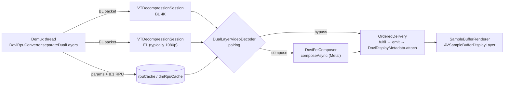

# Dolby Vision Profile 7 FEL

How AetherEngine plays a Profile 7 dual-layer source (base layer + enhancement layer + RPU) as real
Dolby Vision, what has been proven on device, and the design that does it with bounded CPU, GPU and
memory while staying correct.

**Recommendation.** For an app that ships to users, build the curve fold (`DolbyVisionFelCurves`, [section 7](#7-curve-fold-on-the-native-route)) rather than this route: this route reconstructs the picture itself, which evaluates the RPU's MMR chroma prediction and the enhancement layer on every pixel, steps covered by live Dolby patents (the MMR family runs to 2032). A host without a Dolby Vision licence should build `DolbyVisionFelCurves` instead, which leaves every evaluation of the stream's mapping to the platform's licensed decoder. Sections 1 to 6 describe the composer route; section 7 the fold.

**Optional component.** The route and the composer are compiled only with the `DualLayerDolbyVision`
package trait, which is off by default ([README › Optional components](../README.md#optional-components)).
Built without it, `preferDualLayerDolbyVision` is accepted and changes nothing: the route decision
reports `not taken (built without the DualLayerDolbyVision trait)` and every Profile 7 source takes the
native route. Everything below describes a build with the trait; `aetherctl play --fel`, `--cycle-el`,
`--dv-pin`, `aetherctl feltest` and the DEBUG pin test (`armDolbyVisionPinTest`) need it too, and the
pulse probe links the engine with it through `Probes/DolbyVisionPulse/Device/PulseEngine`.

**Platforms.** Nothing in the route or the composer is tvOS-specific: the two VideoToolbox decoders and
the Metal kernels are the same on iOS, iPadOS and macOS, the route has no platform gate, and
`aetherctl play --fel --surface` runs it on a Mac. What is measured per platform is the display half:
that the system reads the per-frame Profile 8.1 attachment and applies Dolby Vision display management
(§4.1) is established on tvOS only. On iOS, iPadOS and macOS the composed picture is correct; how the
system presents its attached metadata there has not been measured.

This is the design document for the feature. User-facing behaviour lives in [formats.md](formats.md#dolby-vision-signaling), options in
[api.md](api.md), tools in [cli.md](cli.md).

Reference device for every measurement below: Apple TV 4K (2nd generation, A12, 3 GB RAM), tvOS 27.0,
HDMI to an LG OLED, 23.976 fps UHD Blu-ray remuxes.

- [1. What is being played](#1-what-is-being-played)
- [2. Output contract](#2-output-contract)
- [3. Current implementation](#3-current-implementation)
- [4. Evidence](#4-evidence)
- [5. Design](#5-design)
- [6. Verification](#6-verification)
- [7. Curve fold on the native route](#7-curve-fold-on-the-native-route)
- [8. Document map](#8-document-map)

---

## 1. What is being played

A Profile 7 access unit carries three things:

| Part | Carriage | Content |
|---|---|---|
| Base layer (BL) | ordinary HEVC NAL units | 3840×2160 HEVC Main 10, BT.2020 PQ, a complete HDR10 picture on its own |
| Enhancement layer (EL) | `unspec63` NAL units (`0x7E 0x01` + an embedded HEVC NAL) | 1920×1080 HEVC Main 10, its own VPS / SPS / PPS |
| RPU | one `unspec62` NAL unit (`0x7C 0x01`) | per-component reshaping curves (polynomial or MMR pieces), NLQ parameters for the residual, and display-management metadata (L1, L2, L5, L8, L9, L11) |

The RPU header says what the EL is for. **MEL** (minimal enhancement layer, `el_type == "MEL"`)
carries no residual: the picture is the reshaped base layer. **FEL** (full enhancement layer) adds a
residual that restores detail and precision the 10-bit base encode lost. `disable_residual_flag` can
switch the residual off for an individual RPU.

Apple platforms decode Profile 5, 8.1 and 8.4 natively and have no Profile 7 dual-layer decoder. That
leaves two ways to play Profile 7:

1. **Convert to single-layer 8.1** on the native path: rewrite each RPU with libdovi mode 2, drop the
   EL. The conversion is lossless for MEL and loses the residual for FEL. Where the display takes
   Dolby Vision that is what plays; where it does not, the native route plays the HDR10 base layer. See `DoviRpuConverter.convertPacketToProfile81`.
2. **Compose BL + EL + RPU ourselves** and present the result with its Dolby Vision metadata. That is
   the subject of this document.

## 2. Output contract

What a composed frame handed to the display layer must be:

- **Pixels.** `kCVPixelFormatType_420YpCbCr10BiPlanarVideoRange` (P010), BT.2020 primaries, PQ
  transfer, colour attachments copied from the base layer. Reconstruction runs at 12-bit precision
  (reshaped base plus inverse-NLQ residual); an ordered 8×8 Bayer dither, inverted on odd frames and
  phase-offset between Cb and Cr, takes it to 10 bits. Luma is clamped to 64–940, chroma to 64–960.
- **Metadata, on every frame.**

  | Attachment | Value |
  |---|---|
  | `DolbyVisionRPUData` | the RPU converted to Profile 8.1 (`dovi_convert_rpu_with_mode(rpu, 2)`), as the `unspec62` NAL **without** its 2-byte header, emulation-prevention bytes kept; a `CFData` |
  | `DolbyCompatibilityID` | the **`CFString` `"1"`**, never a number |

  A frame with no RPU has both attachments removed, because output buffers are recycled from pools
  and would otherwise carry a previous frame's trims.
- **Why Profile 8.1 metadata.** The composed picture is YCbCr PQ over an HDR10-compatible signal, which
  is exactly what a Profile 8.1 RPU describes. Mode 2 keeps L1 / L2 / L5 / L8 / L9 / L11 intact and makes
  the reshaping identity, which is correct because the composer has already applied the real curves.
  Profile 5 (IPT-PQ-c2) would require re-deriving the reshaping for a different colour space.
- **Who consumes it.** `HDRProcessing.framework` inside **backboardd**, on CoreAnimation's external
  display thread, on every vsync (§4.1). Nothing in the app's own process reads it, so no in-process
  instrument can observe consumption.

## 3. Current implementation



| Stage | Code | Thread | What happens per frame |
|---|---|---|---|
| Routing | `VideoRoutingPolicy.requiresSoftwarePath`, `SoftwarePlaybackHost` decoder selection | load | Profile 7 + `preferDualLayerDolbyVision` + `dolbyVisionHandling` `.automatic` + VOD seekable source + hardware HEVC decode + `el_type` FEL + inside the real-time budget (§5.2) → software host, which picks `DualLayerVideoDecoder` (§5.2) |
| Split | `DoviRpuConverter.separateDualLayers` | demux | RPU parsed into composer parameters and converted to an 8.1 NAL; EL NAL units copied into a new `AVPacket`; the BL packet goes to VideoToolbox untouched (it skips the `unspec` NAL units itself) |
| Align | `DualLayerPictureAlignment.enhancementPTS` | demux, under the decoder's lock | each layer's display slot from its POC (`HEVCPictureOrderCount`); the EL packet takes the PTS of the BL picture in the same slot, so pairing by time pairs by picture order when the layers' GOPs differ. A layer whose sequence cannot be trusted (leading pictures of the opener, or more than 16 slots off its unit, or a seek before its next IRAP) keeps its access unit's PTS |
| Decode | two `HardwareVideoDecoder`s | VideoToolbox output threads | asynchronous decode with temporal processing, P010 IOSurface buffers in decode order (the renderer's 4-frame reorder buffer restores display order, as for any VideoToolbox HEVC stream) |
| Pair | `DualLayerVideoDecoder.handleBaseLayerFrame` / `handleEnhancementLayerFrame` | VideoToolbox output threads, under the decoder's recursive lock | match the other layer by 90 kHz canonical PTS within ±300 ticks; a base-layer frame takes its ticket at arrival and is bypassed under it by its display deadline when the decoder has a render clock (§5.5), or once K = 3 newer base-layer frames have arrived when it has none; waiting enhancement frames capped at 10; side data in a 32-entry ring; `hdr10Data` and the display-metadata NAL are resolved once here and travel with the ticket |
| Compose | `DoviFelComposer.acquireSlot(timeout:)`, `composeAsyncWithAcquiredSlot` | compose queue, then Metal | wait for one of 2 in-flight slots, rent a P010 buffer (§5.6), copy colour attachments from the base layer, bind 6 texture-cache textures, serialize the parameter block, encode luma and chroma kernels in one concurrent encoder, commit |
| Deliver | Metal completion handler → composer's `deliveryQueue` (composed frames), or the compose queue (a bypass, or a frame sent out as the base layer while the GPU is stalled) → `OrderedDelivery.fulfil` → `emit` | Metal's completion queue hands off immediately to the composer's own `.userInteractive` queue (§4.3's firewall, not an ordering mechanism), or the compose queue for a bypass, then `OrderedDelivery`'s own `.userInteractive` queue, never the decoder lock | release the GPU slot inline, nothing else, on Metal's queue; everything else (error logging, GPU-time accounting, `completion`) hops off it first. Either path hands the frame to `OrderedDelivery` (§5.7): one serial queue orders composed and bypassed frames alike regardless of which queue called `fulfil`, drops anything tagged with an epoch a flush/close has since retired, and calls `onFrame` (renderer enqueue) with no decoder lock held |

A frame bypasses composition, and goes out as its base layer with its own DV metadata, when the
stream is not FEL, when MEL was detected, when no RPU parameters exist for its PTS, when its
enhancement layer does not arrive in time (§5.5), when the access unit carried none, at end of stream,
or when composition fails. A bypassed frame carries the Profile 8.1 RPU that keeps the source's
mapping, so the display reshapes the picture the composer did not; a composed frame carries the form
with the mapping removed.

**Kernels** (`DoviShaderSource.swift`). Luma: base code → piece selection → polynomial (evaluated in
normalized float) or MMR when the luma curve uses MMR → plus the inverse-NLQ residual of the
enhancement-layer luma, upsampled bilinearly from one gather of the 2x2 footprint with exact weights, the code rounded half up →
12-bit clamp → dither → 10-bit. Chroma: base chroma plus the base luma at the chroma site ([1 2 1] around
the even column in each of the cell's two rows, rows averaged; DoViBaker's MMR input) → MMR → plus the residual from the enhancement chroma, upsampled with the
ETSI GS CCM 001 Annex B.3 default filter (vertical centred, horizontal co-sited; integer arithmetic) → dither.

**Parameter ABI.** `DoviShaderSource.sharedStructs` on the GPU side, `DoviMetalParams.serialize` on
the Swift side. `DoviLayoutProbeTests` has the GPU read every sub-block back at the offset Swift wrote
it to; `DoviShaderSyncTests` pins the serialized size and that every kernel is present.

### 3.1 Audio

Known trade-off of the route, following the maintainer's request to document it rather than work around it.
The dual-layer route runs on `SoftwarePlaybackHost`, so its audio is the host's own `AudioDecoder` (FFmpeg
decode to PCM, played through the sample-buffer audio renderer) and never AVPlayer. On tvOS only AVPlayer
emits Dolby Atmos objects, and the platform does not pass a bitstream through. An E-AC-3 (JOC) track
therefore plays as its channel-bed core (5.1 or 7.1), without the Atmos objects; on the native route the
same track is handed to AVPlayer unchanged. TrueHD behaves as on the native route, which decodes it too and
loses the objects either way. That is the default. With `LoadOptions.objectAudioRendering` set, the host keeps the
objects: an E-AC-3 JOC track goes to the renderer compressed (after the system's Atmos decoder is registered in the
process), and TrueHD Atmos and DTS:X are rendered as APAC. Verified on macOS only; the tvOS behaviour of both is
unmeasured. Hosts that do not set it and want E-AC-3 Atmos on a Profile 7 FEL title leave
`preferDualLayerDolbyVision` off for it. `DualLayerRouteAudioTests` pins the routing half of this.

## 4. Evidence

### 4.1 tvOS consumes the attachment, in backboardd

Two device runs were killed with `SIGKILL` about eleven composed frames in. The app log showed nothing
wrong except `Connection interrupted` and `invalid destination port` from CoreAnimation, which means
the render server died first. The paired Apple TV's own crash reports held two `backboardd-*.ips`
files timed to the runs, and no `JetsamEvent`, which rules out memory pressure. Both had this stack:

```
Exception: EXC_CRASH (SIGABRT), -[__NSCFNumber length]: unrecognized selector
Thread:    com.apple.coreanimation.display.external-0
  CFStringGetIntValue
  -[HDRProcessor applyDoVi81PolicyWithInput:WithRPU:]
  -[HDRProcessor processFrameInternalWithLayer0:layer1:outout:metadata:commandbuffer:…]
  CA::HDRProcessorInternal::tonemap_surface_internal(__IOSurface*, …, __CFData const*, …)
  CA::HDRProcessorInternal::create_surface_with_forward_dm
  CA::Render::ImageQueue::forward_dm
  CA::WindowServer::IOMFBServer::vsync_callback
```

That is the proof of consumption: on the vsync callback, CoreAnimation pulls display management off
our IOSurface and applies Dolby Vision 8.1 policy with our RPU. It is also the bug: the policy parses
`DolbyCompatibilityID` with `CFStringGetIntValue`, and we had attached a `CFNumber`. Decoding a
Profile 8.1 asset through `AVAssetReader` and printing the CF type of VideoToolbox's own attachments
confirmed the fix:

| Attachment | Class | CF type | Value |
|---|---|---|---|
| `DolbyCompatibilityID` | `NSTaggedPointerString` | `CFString` | `"1"` |
| `DolbyVisionRPUData` | `__NSCFData` | `CFData` | 188 / 189 bytes |

The payload form was established the same way: VideoToolbox's `DolbyVisionRPUData` matches the
bitstream's `unspec62` NAL byte for byte once the 2-byte header is removed and the emulation-prevention
bytes are left in; the EPB-stripped RBSP is 176 bytes and does not match.

Two consequences carry forward. A malformed attachment crashes the render server and looks, from
inside the app, like an unexplained kill; suspect the attachment before memory. And the device crash
reporter (`devicectl … --domain-type systemCrashLogs`) is the instrument for anything that happens
out of process.

### 4.2 Throughput: the composer must not block decode

Playback first ran with `compose` ending in `waitUntilCompleted()` under the decoder lock. The deficit
was steady, not a hitch:

| | Blocking compose | `composeAsync` + one encoder |
|---|---|---|
| Delivered rate | 21.4–22.0 fps | real time, ~26.6 fps while catching up after a seek |
| Video lead | slipping 0.09 s per second | flat at about +0.5 s |
| Display drops | +3…+7 every second | flat after seek settling |
| GPU time per frame | 28 ms end to end, serialized | 14.3 → 12.9 ms, off-thread |

Most of the original 28 ms was the wait and the CPU-side setup, not GPU work: the A12 has about 3×
headroom against the 41.7 ms budget at 23.976 fps. The two serial compute encoders were merged into
one concurrent encoder because the luma and chroma kernels never read each other's output; the
bit-exactness suites passing unchanged is what proves that moved no pixels.

### 4.3 The completion-handler deadlock

Metal runs every `addCompletedHandler` block for a command queue on one serial queue. The first async
version delivered from inside that handler, which took the decoder lock, while the caller held the
same lock waiting in `inFlight.wait()` for the signal that only a later handler could send. Playback
stopped after about ten seconds with the session still reporting healthy. The fix, and a rule for any
future change: **release the slot inline in Metal's handler and do nothing there that can block; hop
to another queue for everything else.** `DoviComposeAsyncTests.doesNotDeadlockAgainstTheCallersLock`
reproduces the exact lock shape; against the old handler it hung past a 300 s timeout.

### 4.4 Earlier fixes worth remembering

| Symptom | Cause | Rule |
|---|---|---|
| Metal validation abort binding textures | integer kernel access on a Unorm texture | bind BL and output planes as `r16Uint` / `rg16Uint`, EL planes as `r16Uint` / `rg16Uint` too (read with explicit texel fetches, no sampler filtering) |
| Black picture with `COMPOSE SUCCESS` on every frame | 10-bit prediction treated as 12-bit | keep the whole reconstruction in one declared precision |
| Green / purple picture | chroma curves with fewer than 2 pivots returned 0 | an absent curve is identity, not zero |
| GPU reading freed memory | `CVMetalTexture` wrappers released before completion | keep textures *and* their source buffers alive until the command buffer retires (`ComposedFrame`) |
| Layers never pairing | container vs decoder timestamp scales | canonicalize to 90 kHz and match within ±300 ticks |
| EL decoder never opening | EL VPS / SPS / PPS split across packets | accumulate parameter sets across packets |
| Profile 7 plays as plain HDR10 | the container carries no `dvcC` record, so the load never sees a Profile 7 (routing and the `el_type` probe both start from the record) | none: the file plays as its HEVC base layer, the `unspec62` / `unspec63` NAL units ignored. `DolbyVisionRecordAudit.addRecordIfProfile5` repairs a recordless Profile 5 only; for Profile 7 the fix is a remux that writes the record |

### 4.5 Consumption test assets

`aetherctl dvsurvey` ranks frames by L1 distance from the title's median so that the pin test can
pin a frame whose metadata is a large lie. On the three local test clips: a CMv4.0 4000-nit clip pins
frame 247 (`max_pq` 4095 against a median of 2081, distance 3876, the best asset); a scene clip gives
distance 1391, usable; a credits clip has static L1 (distance 0) and is correctly rejected as `WEAK`.

The consumption question, whether the panel uses the RPU the engine attaches rather than only
switching into a Dolby Vision mode, is answered by a pulse test that anyone with an Apple TV, a
television and a phone can repeat: clips whose pixels are constant while only the RPU (or the
enhancement-layer residual) switches, played through AVPlayer, VideoToolbox and the FEL route, and
filmed. Clip generator, device host, harness scripts and analysis are in
[`Probes/DolbyVisionPulse`](../Probes/DolbyVisionPulse/README.md).

### 4.6 Caveat on the numbers

Every device figure above came from DEBUG builds: `-Onone`, with the HDMI probe retrying and the
memory watermark sampling on every emitted frame. They show the direction and the GPU cost; CPU and
memory should be re-measured on a release build. Footprint went from a flat ~390 MB to a plateau of
~705 MB with the async pipeline; §5.10 accounts for the pipeline's own share.

### 4.7 4:4:4 chroma compose on the A12

Measured on an Apple TV 4K (2nd generation) with the 4:2:0 output as the control, running the
4:4:4 kernel described in §5.6. The build kind is given per row.

| | Before | After |
|---|---|---|
| 4:4:4 compose rate, 65 s clip (Debug) | about 12.8 per second, video falling 30 s or more behind the clock | about 23.9 per second, the clip's rate; 4:2:0 control 24.1 per second; video lead 0.2 to 0.3 s, 0 drops |
| 4:4:4 compose rate, 65 s clip (Release) | not measured | 24.0 per second, 1555 frames composed (last totals line; it prints at most every 10 s), 4:2:0 control 24.0 per second and 1577 frames; video lead up to 0.25 s, 0 drops, 0 compose failures |

- **4:4:4 costs memory.** On the Release runs above, footprint (sampled at 30 s and 60 s) is 792 MB
  against 436 MB for 4:2:0 on this code. In Debug builds of the same clip, 4:4:4 was 618 MB before
  this kernel and 762 MB with it; 4:2:0 was 429 MB and 424 to 430 MB. The kernel allocates no new
  textures, and the cause of the rise is not measured. 4:4:4 takes the pool path while the 4:2:0
  control composes in place, and its chroma planes are larger; the split between the two is not
  measured.

---

## 5. Design

VideoToolbox decodes both layers, one concurrent Metal encoder composes them, each frame carries the
Profile 8.1 attachment, delivery is ordered by ticket, and the GPU slot is released inline. The
sections below are the rules that keep per-frame work and shared mutable state to a minimum.

### 5.1 Principles

1. **Decide once per stream, not per frame.** FEL vs MEL is a property of the encode; routing and
   decoder setup decide it, and no callback changes it.
2. **Touch each byte once.** One libdovi parse per RPU, no copy of the base-layer access unit.
3. **Nothing blocks while holding a lock, and every piece of state has one owner.**
4. **Every frame has a bounded lifetime.** Bounded wait for its partner, bounded queues, bounded GPU
   work in flight, and nothing from before a flush survives it.
5. **Per-frame work writes no log lines at the default level.** Counters feed a 1 Hz summary, which is
   a `.verbose` line (§5.11).

### 5.2 Routing

The load probes the first RPU's `el_type` (`DolbyVisionRecordAudit.probeEnhancementLayerType`) and
passes it into `VideoRoutingPolicy`:

| Source | `dolbyVisionHandling` | `preferDualLayerDolbyVision` | Device | Route |
|---|---|---|---|---|
| P7, `el_type` FEL | `.automatic` | true (opt-in; the default is false) | VideoToolbox HEVC hardware + Metal | software host, `DualLayerVideoDecoder` |
| P7, `el_type` FEL | `.automatic` | false (the default), a build without the `DualLayerDolbyVision` trait, or no VideoToolbox HEVC hardware decode | any | native (8.1 conversion where the display takes Dolby Vision, otherwise the HDR10 base layer) |
| P7, `el_type` MEL | `.automatic` | any | — | native (as above; the conversion loses nothing for MEL) |
| P7, any | `.baseLayerOnly` | any | — | HDR10 base layer |

The software host then instantiates `DualLayerVideoDecoder` only for the first row; a Profile 7 forced
onto the software path by any other combination gets a plain `HardwareVideoDecoder` for the base layer.

### 5.2.1 The capability gate and its diagnostic line

The route is FEL only and capability gated (`DualLayerRouteDecision`, pure and unit-tested). Everything
else keeps the native route, which plays single-layer 8.1 where the display takes Dolby Vision and the
HDR10 base layer where it does not: the preference is off, the build lacks the `DualLayerDolbyVision` trait, `dolbyVisionHandling` is not `.automatic`, a
live or non-seekable source, a box with no hardware HEVC decoder for the stream, an AirPlay video receiver on the audio route (iOS, as the host reports it), a MEL source (nothing
to compose), an enhancement layer the probe could not classify, a base layer of unknown size, and a
stream the box could not decode twice in real time. The checks run in that order (the code's order:
preference, trait, handling, live/seekable, hardware, AirPlay video receiver, `el_type`, geometry, budget). The `el_type` probe (a packet
scan and a seek) runs once nothing up to and including the AirPlay receiver check has ruled the route out, so it
also runs for a stream that the geometry or the budget then refuses: the MEL / unknown answer outranks
the size reasons in the log line, and that precedence needs the probe's answer.

The real-time budget is a pixel rate, base layer plus enhancement layer, from the stream's width, height
and frame rate: `DualLayerRouteDecision.maximumPixelsPerSecond`, 311.04 Mpx/s, which is UHD
3840x2160 at 30 fps plus a 1920x1080 enhancement layer at 30 fps. The enhancement layer is taken as a
quarter of the base layer's area (what a 4K FEL disc ships), and an unknown frame rate is budgeted as 24
(the line says "assumed"). The load passes no enhancement-layer size, so it always budgets the quarter-area
layer (every retail FEL title's layout); a 1:1 enhancement layer is not detected at load. A base layer whose
width or height is unknown (not positive) is refused rather than budgeted at zero. A 24p UHD FEL master needs 80% of the budget. What is measured: the Mac soak runs in the PR
description (M2 Pro, debug `aetherctl`), and, from earlier development builds on an Apple TV 4K 2nd
generation, the composer's GPU time of 12.9-14.3 ms per frame against a 41.7 ms frame at 23.976 fps
(§4.2, a debug build and a previous iteration of the pipeline, not this stack). The 311 Mpx/s ceiling,
and 30 fps as a margin above 24p, are an assumption until the Apple TV run of this stack. UHD at 60 fps
(200%) and 8K fall back.

**Split sources.** A UHD Blu-ray clip carries the enhancement layer on its own PID (`0x1015`, with its own RPUs),
and a Matroska or MP4 file may carry it as a second video track (a `dvcC` record on each track, the enhancement
track declaring the enhancement layer present and the base layer not). The dual-layer route reads one track, so the
demuxer joins the two (`Demuxer.enableDolbyVisionEnhancementLayerJoin`, `DolbyVisionLayerJoin`) into the unit a
single-track remux carries: the n-th base access unit and the n-th enhancement access unit, each layer in its own
decode order, anchored at an IRAP the layers share (after a seek, units before it are retired). A missing or extra
enhancement unit is repaired by presentation time once sixteen units agreed; a source whose layers never share an
IRAP plays base-only. A transport stream's packets are rewritten to four-byte length prefixes and its record to an
hvcC. The load switches the join on when the route is wanted and switches it off again when the route is not taken,
so the 8.1 path (`BluRayDolbyVisionLayers`, the RPUs folded into the base layer) is untouched.

A Profile 7 load logs exactly one line, whichever way it goes (other sources log nothing here):

```
[AetherEngine] DV P7 dual-layer route: taken (el_type=FEL, 3840x2160@23.976, budget 80%)
[AetherEngine] DV P7 dual-layer route: not taken (el_type=MEL, nothing to compose), keeps the native route (8.1 where the display takes Dolby Vision)
[AetherEngine] DV P7 dual-layer route: not taken (preferDualLayerDolbyVision is off), keeps the native route (8.1 where the display takes Dolby Vision)
[AetherEngine] DV P7 dual-layer route: not taken (built without the DualLayerDolbyVision trait), keeps the native route (8.1 where the display takes Dolby Vision)
[AetherEngine] DV P7 dual-layer route: not taken (over the real-time budget, 3840x2160@60 needs 200% of it), keeps the native route (8.1 where the display takes Dolby Vision)
[AetherEngine] DV P7 dual-layer route: not taken (base-layer size unknown), keeps the native route (8.1 where the display takes Dolby Vision)
[AetherEngine] DV P7 dual-layer route: not taken (enhancement layer on its own PID (UHD Blu-ray), only its RPUs are folded in), keeps the native route (8.1 where the display takes Dolby Vision)
```

A missing Metal device does not fall back to the native route: the routing decision above has
already been made, so the software host keeps the base layer alone on a `HardwareVideoDecoder` (HDR10,
no composition). The same is true after the fact: if the compute shaders fail to compile, the decoder
stays but every frame goes out as its base layer.

### 5.2.2 The display is not consulted

The route decision does not look at the display. With `preferDualLayerDolbyVision` on and a display
that does not take Dolby Vision (an SDR or HDR10-only panel or mode), the route is still taken when
the gate above passes: the software host composes the full FEL picture and presents it with the
Profile 8.1 metadata attached (§2), and how tvOS presents that on such a display is up to the platform.
The native route, by contrast, strips the Dolby Vision for such a display (`CodecRoutePolicy`) and plays
the HDR10 base layer. A host that wants the base layer on a non-Dolby-Vision display leaves the flag off,
or sets it from what it knows of the display. The audio trade-off of §3.1 (an E-AC-3 Atmos track plays as
its channel-bed core, without the objects unless `objectAudioRendering` is set) applies on this route whatever the display. This is the current
behaviour, documented rather than designed; it is not changed here.

### 5.2.3 What the route gives up against the native route

The dual-layer route runs on the software host: there is no `AVPlayer` and no `AVPlayerItem`, and the
picture is drawn into an `AVSampleBufferDisplayLayer`. Everything that AVKit or the loopback HLS
server provides to the native route through the item is therefore either replaced by an engine
equivalent or absent. With `preferDualLayerDolbyVision` off none of this changes. The comparison,
checked against the code:

| Feature | Native route | Dual-layer route |
|---|---|---|
| Picture in Picture | `AVPlayer`-based: the stock `AVPlayerViewController` and a host-built `AVPictureInPictureController` both work. | No `AVPlayer`, so no stock player PiP. The engine publishes `SoftwarePiPSource` (the layer plus the transport answers for a sample-buffer PiP content source) and the host builds the `AVPictureInPictureController` around it; while PiP is active, subtitle cues are drawn into the frames by `SubtitleFrameCompositor`, which carries the pixel-buffer attachments through. Whether the PiP window presents the composed picture as Dolby Vision is not measured. |
| Scrub thumbnails | With `serveIFramePlaylist`, an `EXT-X-I-FRAME-STREAM-INF` rendition next to the master, so a stock `AVPlayerViewController` draws its own thumbnails and scans on I-frames, plus `scrubThumbnail(atSeconds:)`. | No I-frame playlist, so a stock player shows no thumbnails of its own. `scrubThumbnail(atSeconds:)` answers from the software host's retained packet cache (`servesPacketCacheStills`) and only when that cache exists: a local file is read directly and has none, so there the call returns nil. The still is the base layer decoded by libavcodec, not the composed picture. |
| Subtitles | Text tracks can be declared in the init segment and served as WebVTT renditions (`prepareNativeSubtitles`), so `AVMediaSelection`, PiP and external screens render them. | No renditions and no `AVMediaSelection`. The engine decodes the cues and publishes them; the host draws its own overlay in the app. They appear in a PiP window only through the frame compositor above, and the system caption styling does not apply. |
| AirPlay | `AVPlayer` hands the receiver the stream (the engine serves the loopback over the LAN address for it). | The layer draws on the device and only the audio renderer follows the route, so a wireless receiver plays sound only. The engine publishes `airPlayPictureStaysLocal` (iOS) so a host can say so. When the host reports that the receiver shows video (`setAirPlayReceiverShowsVideo(_:)`), a FEL source takes the native route instead (8.1 where the display takes Dolby Vision, no enhancement layer) so the receiver gets a picture; an audio-only output such as a HomePod keeps the dual-layer route. This is decided at each load: on a URL source `reloadAtCurrentPosition()` decides again, a custom source keeps its route until the next `load()`. Not applicable where the device is itself the receiver. |

A host that needs any of these for a Profile 7 title leaves the flag off for it, as for the Atmos
trade-off of §3.1.

### 5.2.4 The AVPlayer-output route

`LoadOptions.dualLayerRoute == .avPlayerOutput` composes the same picture without the software host.
It is opt-in (the default is `.softwareHost`), needs the `DualLayerDolbyVision` trait and applies only when
the route decision above took the dual-layer route and the stream has a usable frame rate; anywhere else the
session loads as with `.softwareHost` and the log says why. It compiles on macOS, tvOS and iOS. It was run
on macOS only: tvOS and iOS compile and are selectable, and nothing of it ran on a device.

| Part | What it does | Code it reuses |
|---|---|---|
| Base layer and audio | `AVPlayer` plays the engine's loopback HLS stream: the base layer with the RPU converted to Profile 8.1 and the enhancement layer dropped, as on the native route, plus the audio. The item owns the clock. The forward-buffer window of the session is capped at 10 segments (the default) on this route, see the ring below. | the native route, unchanged |
| Base-layer frames | An `AVPlayerItemVideoOutput` asks for biplanar 10-bit (`x420`) buffers with no colour conversion and the player's own picture is hidden with `suppressesPlayerRendering` (public API). Frames are taken 0.15 s ahead of the item clock, one per frame interval, never replaced by a later one. | |
| Enhancement layer | `VideoPacketTap` sees each source packet in the segment producer's single read, before the 8.1 conversion strips the enhancement layer, and again once the segment muxer has written it, with the instant the stream shows it. No second connection and no second demuxer. The packets go to a bounded on-disk ring (`VideoPacketHistory`, 1 GiB at most, unlinked at once so nothing outlives the process) that keeps the newest bytes, so a seek back into content the ring still holds finds its enhancement layer; the feed restarts at the nearest held keyframe at or before the clock whenever the clock jumps. The producer runs up to the forward-buffer window ahead of the playhead, and that lead is spent from the ring first, which is why the window is capped: a lead longer than the ring would leave the playhead without an enhancement layer. | the producer's read |
| Pairing, composition, metadata | `DualLayerVideoDecoder.openExternalBaseLayer(...)` takes frames from the host instead of decoding the base layer, and from there everything is the code the software host runs: the packet split, the enhancement-layer decoder, the pairing by presentation time, `DoviFelComposer` (the Metal kernels), the per-frame RPU and display metadata, the ordered delivery. The composer writes in place into the buffer the video output handed over, as it does into VideoToolbox's buffers on the software host, and takes the engine's output pool only for a frame it cannot compose in place (the same `canComposeInPlace` check). No API contract says the player's buffers are writable: on the Mac the video output vends converted copies (below) and the in-place result is bit-identical to the pool's; whether a tvOS player ever vends a buffer it still reads is the same open question as the software host's copy opt-out, and `AETHER_FEL_OUTPUT_INPLACE=0` turns it off for that comparison. | all of it |
| Display | `SampleBufferRenderer` feeds an `AVSampleBufferDisplayLayer` whose control timebase is a child of the item's timebase, so a pause, a rate change or a seek of the item moves both. The layer is an overlay above the `AVPlayerLayer` in `AetherPlayerView`. | the software host's renderer |

**Dither is the one difference from the software host.** The compose kernels dither on the parity of a frame
index. The software host counts compositions; with the base layer delivered by AVPlayer that count would
depend on which frames reached the composer and when, so on this route the index is the frame's position in
the stream (presentation time times frame rate). With the host given the same index rule, the composed
picture of a 91 s clip is bit-identical to this route's (0 of 2181 frames differ, every plane and every RPU
attachment). Against the software host as committed, the two routes differ on about 58% of frames, by at
most one 10-bit code in a sample, and the picture and the RPU differ in nothing else (the route's frames also carry a few extra player attachments) (23 raw frames sampled across the clip: 75.8 million of 286 million samples differ, all by exactly one code). So the two routes are not bit-identical; they
share the maths and differ in the dither pattern.

**Where there is no enhancement layer.** A position the history does not cover (a seek further back than it
reaches, a packet it could not store) shows AVPlayer's own base-layer frame at once, so the screen never
freezes while the audio plays. A base-layer frame whose enhancement packet is only late waits 0.1 s and then
goes out as the base layer too. The composed picture resumes as soon as the layers pair again. After a seek
beyond the ring the position stays on the base layer until the playhead reaches packets the ring holds,
because the segment cache serves the segments without the producer reading them again. Every seek, forward or
backward and of any length, resets the feed from the clock: the player's own time-jump notification is the
signal, with a clock more than 1.5 s from the feed as a second net.

**External screens and Picture in Picture.** When an AirPlay video receiver or an external display holds the
picture (at load, or when the route changes during the session), the route is stopped and AVPlayer shows its
own picture, the Profile 8.1 base layer without the enhancement layer; the log carries
`[DualLayerOutputRoute] another screen ...`. The route is decided again at the next load or rebuild of the
session, not when the receiver goes away. Picture in Picture is not offered while the route runs
(`nativePlayerLayer` is nil, there is no `softwarePiPSource`): the composed picture is a layer of
`AetherPlayerView`, so a window built on AVPlayer's own layer would be blank. Subtitles were not checked on
this route. A host that draws video in its own `AVPlayerViewController` gets no picture from the route and
should leave the option off.

What it gives up against the software host: after a seek the clock runs while the enhancement layer is
still decoding up to the target, so a few frames after a seek can go out as the base layer (up to 5 after one seek, and 0 to 9 in ten short seeks, forward and back, over four runs on the Mac); the
software host holds its clock for this. What it gets: AVPlayer's audio routes (the Atmos trade-off of §3.1
does not apply), the native seek and rate behaviour, and no software-host audio pipeline. Memory is higher
than on the software host. Measured on the Mac (M2 Pro) on a 4K 23.976 fps Profile 7 FEL clip, release `aetherctl`,
`footprint` at 50 s of playback, the process and `VTDecoderXPCService` together:

| Run | Process | Decoder service | Total |
|---|---|---|---|
| plain native route, no enhancement layer | 167 MB | 308 MB | 475 MB |
| software host (in place) | 44 MB | 468 MB | 512 MB |
| this route, pool as the compose target | 338 MB | 704 MB | 1042 MB |
| this route, in place (the default) | 225 MB | 703 MB | 928 MB |

Composing in place removes the pool (IOSurface in the process 166 to 48 MB). What remains is AVPlayer's own
pipeline: its demuxed sample queue (`CoreMedia Memory Pool`, about 114 MB, the same as on the plain native
route) and, in the decoder service, about 235 MB more than the base layer and enhancement layer decoders
need. That share is the video output's: AVPlayer decodes into a lossless-compressed format (`&xv0` on the
Mac) and converts every frame for the output into the `x420` the route asks for, holding both copies. A
video output that asks for no format gets `&xv0` and the decoder service drops to 432 MB, but the composer
reads the base layer as 16-bit planes, which a packed compressed buffer is not, so the route cannot take it.

A composition runs on the thread that hands the decoder the frame: the route's pull thread, or VideoToolbox's callback thread when the enhancement layer arrives last (on the software host it always runs on the decoder's callback thread). A pull tick can therefore wait for a free GPU slot, a wait that ends when the GPU completes one. `stop()` detaches the route on the main thread and returns; closing the decoder and waiting for the ticks run on a teardown queue, which waits at most 2 s for a pull or feed tick. Closing the decoder itself still waits for the enhancement-layer session, as on the software host, so a GPU that never completes can still hold that queue, but not the main thread.

### 5.3 Packet split

One walk over the access unit's NAL units, on the demux thread:

- **RPU:** `dovi_parse_unspec62_nalu` once. From that handle read the header (`disable_residual_flag`),
  the data mapping (into `DoviMetalParams`), then convert with mode 2 and write the 8.1 NAL. Strip its
  header once into the attachment `Data`.
- **EL:** copy the embedded NAL units into the EL packet (one 1080p copy, unavoidable because
  VideoToolbox needs a standalone access unit).
- **BL:** hand the packet to VideoToolbox **untouched**. The format description is built from the base
  layer's parameter sets with no `dvcC`, so `unspec62` and `unspec63` are unknown NAL types it skips.
  The rebuild stays only in `convertPacketToProfile81`, where the container does declare Dolby Vision.

Side data goes into a **`FrameSideDataRing`** keyed by canonical PTS: `{ params, dvPayload, flags }`,
fixed capacity 32 (reorder depth plus maximum layer skew with margin). Insert overwrites the oldest,
lookup scans at most 32 entries for the nearest key within ±300 ticks. No sorting, no dictionaries.

### 5.4 Decode

Two `HardwareVideoDecoder`s. `HardwareVideoDecoder.decode` wraps the packet's memory with
`CMBlockBufferCreateWithMemoryBlock` and a custom block source that holds an `av_buffer_ref` of
`packet.buf` and unrefs it in `FreeBlock`, so VideoToolbox can retain the data past the call without a
copy. When `packet.buf` is nil it falls back to the copy. This benefits every HEVC source on the
software path, not just FEL.

### 5.5 Pairing

Pairing lives in `DualLayerVideoDecoder.handleBaseLayerFrame` / `handleEnhancementLayerFrame`, under
the decoder's lock, and each call is O(K):

- A **base-layer frame takes its ticket when it arrives.** VideoToolbox outputs in decode order, so
  ticket order is decode order, whatever happens to the frame later. Display order is restored
  downstream, by the renderer's reorder buffer (4 frames, the same depth as a single-layer hardware
  decode; `DoviFelRealFileTests.reconstructsAndOrders` replays that rule on the real files).
- If its enhancement layer is already waiting (within ±300 ticks), the pair is composed. Otherwise it
  waits.
- **A waiting base layer is bypassed, under its own ticket, by its display deadline; with no render
  clock, once K newer base-layer frames have arrived.** K (`maxLayerSkewFrames`) is the maximum layer
  skew, 3, and is the whole rule only when the host installed no clock (`setRenderClock`): a lost
  enhancement frame then costs K frames of delay and never reorders output. The summary line reports
  the observed skew (§5.11). With a clock (the software host installs one) the rule is the deadline:
  - *Deadline.* A waiting frame is released as its base layer once its presentation time less a margin
    has been reached on the running clock. The margin is `maxFramesInFlight` (3) frame intervals, at
    least 100 ms. Its presentation time is the earliest of its own and those of the frames behind it,
    since delivery is ordered by ticket and none of them can show first.
  - *Grace.* A frame is given one frame interval, clamped to 15 to 50 ms, from its arrival before the
    deadline may release it, because the two layers decode on separate sessions and the partner of a
    frame that arrives already inside its margin is normally a moment behind, not lost. A frame already
    at or past its presentation time gets none.
  - *Held clock.* With no running clock there is no time to count down to. While a preroll waits on the
    renderer a frame waits the margin of wall time at most; for a pause, or before the clock is armed,
    it waits 2 s at most (this only bounds a layer that is lost for good).
  - *Backstop.* With a clock, `maxDeadlineHoldFrames` = 6 newer arrivals release a frame in every mode.
    It sits two below the point (`maxFramesInFlight + maxLayerSkew + 2` = 7 pending frames) at which
    `OrderedDelivery`'s stall guard skips a ticket, so the frames queued behind a waiting one can never
    reach the guard, and it bounds the queue.
  - *Sweep.* A timer re-checks what waits (every 2 to 250 ms, only while something waits) and every
    arrival re-arms it, since an arrival can lower a waiting frame's deadline.
  - *No enhancement layer in the access unit.* An access unit that carries no enhancement-layer NAL has
    no picture to wait for, so its base frame is released at once (`bypassNoELInAU`). That is judged only
    while the layers' pictures sit in the same units; once the alignment has restamped any (a reordered
    stream), a unit without one says nothing about its own frame. A reordered stream is recognised only
    after its first restamp, so a frame in that start-up stretch (the opening of a play and of each seek)
    can be released early and shown as its base layer.
  - The count `K` also sets how far back the picture alignment will restamp (`maxBackwardRestamp`); with
    a clock a frame waits longer than `K` arrivals, so that bound is conservative there.
- An enhancement frame whose base layer has already gone out (its key matches one of the last 64
  settled base-layer keys) is dropped on arrival. At most 10 enhancement frames wait.
- A frame's side data is looked up once, when its base layer arrives, and travels with the ticket;
  delivery never touches a shared cache.
- The `disable_residual_flag` of an individual frame becomes a kernel flag
  (`DoviComposerFlags.disableResidual`); it never changes the stream classification.

### 5.6 Compose

- **Acquire the in-flight slot on a compose queue, outside every lock.** The VideoToolbox output
  thread that pairs a frame only records, pairs and enqueues it (`runCompose`); the slot wait, encode
  and commit run on one serial `composeQueue`, in hand-off order. A callback that waited for the GPU
  would stall that session's whole output, because VideoToolbox can call it on the submitting thread.
  The queue waits with no lock held, so `flush()`, `close()` and the other layer's callback never wait
  behind the GPU.
- **Backpressure is the feed's.** `decode(packet:)` waits (`waitForComposeBacklog`) while
  `maxComposesAwaitingSlot` (= the in-flight slots, 2) compositions are queued for a slot, which holds
  the demux thread and, through `mayEnqueueVideoFrame`, the host's reads. The wait has no clock of its
  own. It ends when the queue head gets a slot, is retired, or reaches the stall verdict below, or when
  `flush()` or `close()` moves the epoch; in that last case the packet is refused, because it belongs to
  the old feed. The backlog, and the buffers it holds, are therefore bounded whatever the GPU does.
- **A stalled GPU is recoverable, and bounded.** The queue head waits for its slot in
  `composeStallSlices` (4) slices of `composeStallTimeout / 4` (2 s by default). When all of them time out
  in a row, the decoder enters *stall mode*; the verdict counts timed-out waits and never compares clock
  readings, so a process suspension (a debugger, a background freeze) counts as at most one slice.
  In stall mode each queued request takes a slot only if one is free right now and otherwise goes out as
  its untouched base layer with the mapping-preserving RPU (the form a failed composition delivers),
  in queue order, without waiting. Compositions already on the GPU are left alone: they deliver if they
  complete, and `OrderedDelivery`'s stall guard (§5.7) skips their tickets if they never do. Stall mode
  ends when a request gets a slot again (the GPU progressed) and on `flush()` or `close()`; the first
  head after a seek then waits one full timeout before the mode can resume. It is logged on entry and
  exit, counted (`composeStallCount`) and summarised (§5.11).
- **The bound.** A stall that does not recover must not fall back to the base layer forever. Two counts,
  both of frames and verdicts and never of clock time, end it in a reported stop: a single stall mode that
  sends `maxComposeStallBypassFrames` (600, about 25 s at 24 fps) frames as the base layer without one slot
  coming free, and `maxComposeStallEpisodes` (3) stall verdicts that were not separated by
  `composeHealthyFramesToResetStalls` (240, about 10 s) compositions that got a slot; a flush resets the
  per-stall count of base-layer frames, and only the episode count survives it, so every flush during a dead
  GPU still costs one verdict and the 4th is reported. Past either, the compose queue reports `VideoDecoderError.composerStalled` once,
  through `onFatalDecodeError` (the path a failed primary open uses; the software host turns it into
  `softwarePipelineFailed`), and `fatalDecodeError` holds it; `decode(packet:)` refuses packets from then on.
  The report is made on the compose queue with no decoder lock, backlog lock or counter lock held, so the
  host's handler can call back into the decoder. Frames already queued still go out as the base layer.
  Ending the session, rather than staying on the base layer, is deliberate: a base-layer picture on a
  stream the host asked to be composed is a silent loss of the enhancement layer that looks like
  success, and only a reported error lets the host act on it (retry, or choose another route). Whether
  that is the right product behaviour is the maintainer's call; the bound is the two constants above.
- **A bypass goes through the same queue** (`fulfilBypass`), behind every composition handed off
  before it, so it cannot overtake queued compositions and push their tickets past the stall guard. The
  price is that it can wait behind a head that is waiting for a slot, bounded by the first of: the next
  slot release, the stall verdict, or (after a flush) one slice. The summary's `bypassQueueWaitMaxMs`
  measures that wait on a device.
- **Parameters** are written straight into one of `maxFramesInFlight` preallocated shared
  `MTLBuffer`s (`DoviMetalParams.serialize(into:)`), bound with `setBuffer` for both kernels. No `Data`,
  no heap arrays per frame.
- **Output pool** gets `kCVPixelBufferPoolAllocationThresholdKey` = the renderer's FEL look-ahead (9)
  + the frame on screen and the one the display layer retains (2) + the in-flight slots (2) + 1, so 14.
  A refused buffer would put a base-layer frame on screen, a visible brightness step, so past the
  threshold a burst draws on a reserve of 3 more. Only with the reserve spent does the composer wait,
  for at most about 36 ms (a 300 ms wait stalled the VideoToolbox callback and starved audio into
  rebuffers on device), and then the frame bypasses instead of growing the pool.
- **Chroma sampling (experimental switch).** The composition is defined on the 4:2:0 sites, where the base
  layer's chroma sits, and 4:2:0 is the output unless `AETHER_FEL_CHROMA` says otherwise. `422` and `444`
  step that result up by co-sited means: a copy on a site, and the mean of the sites either side between
  them (the four around a sample in 4:4:4). 4:2:2 composes each step-up site again from its neighbours,
  so it does about four times the chroma work of 4:2:0; a pass that composes the 4:2:0 sites once into a
  scratch texture would remove that, and it has not been done. 4:4:4 does not recompute: its kernel works
  on 16 x 16 blocks of output samples, composes the 9 x 9 sites a block needs once into threadgroup
  memory, and every sample then takes the mean of its one to four stored sites with the same rounding,
  clamping and dither as before, so the output is byte-identical to the per-sample version. That is 81
  site evaluations per 256 samples instead of 1024 (0.32 per sample against 4, and 0.25 for 4:2:0). The
  Mac's mean GPU time for a 4:4:4 frame went from 21.0 to 3.8 ms (the pool path, a 4:4:4 FEL test clip
  played for 60 s with the debug `aetherctl` build, mean of the once-a-second summary lines after the
  first three; the 4:2:0 kernel measured 2.8 ms on the same Mac before and after), and the A12 numbers are
  in §4.7. Both take the pool path, since in-place composition is 4:2:0 only. The kernel needs
  threadgroups of exactly 16 x 16, so a pipeline that allows fewer than 256 threads refuses the frame with
  a logged compose failure; the per-window GPU time line carries the limit it saw. 4:4:4 is experimental:
  the spec has no 4:4:4 reconstruction.
- **In place.** When the decoded base-layer buffer allows it, the result is written into that buffer
  instead of a pool buffer, so the output pool above is not created unless a frame is refused for in-place
  (for example a luma MMR curve). It is used when the buffer is
  IOSurface-backed, in the 10-bit biplanar video-range format (`x420`), has even dimensions with the
  luma and half-size chroma planes the output has, the frame's luma curve is not MMR, and the device
  binds the planes as `read_write` textures (`readWriteTextureSupport` is tier 2, which the 16-bit luma plane
  needs; the chroma plane is bound as 32-bit texels, one Cb and Cr pair each, which tier 1 covers); anything
  else takes the pool path unchanged. The in-place kernels are the pool kernels' bodies, with one `read_write`
  binding per plane. They are compiled only on a tier 2 device, as a separate block of the shader source, so a
  device below tier 2 builds no `read_write` text; if a tier 2 driver refuses either in-place pipeline, every frame
  takes the pool path. The tier and whether in-place is on are logged once at the default level when the composer
  is created. Setting `AETHER_FEL_INPLACE=0` turns it off for an A/B run.
  - *Why no scratch buffer.* The chroma kernel reads the base-layer luma around each chroma sample
    (other threads' pixels) but only its own chroma sample. The luma kernel reads only its own luma sample.
    So chroma runs first, while all the luma is still the decoded base layer, and each thread overwrites
    just the chroma sample it has read; luma runs second, each thread overwriting just its own sample, and
    nothing reads luma any more. A serial encoder and a texture barrier between the passes make the second
    wait for the first. A luma MMR curve would read chroma in the luma pass, after chroma was overwritten,
    so such a frame uses the pool (no stream seen so far has one).
  - *Exclusive buffer.* The decoder hands the buffer to the composition when it pairs the frame, keeps no
    other reference that reads pixels, and delivers it to the renderer only from the completion. The
    composer refuses a second composition of a buffer while one is outstanding (that request is dropped and
    counted as lost, it does not take the pool path, which would read pixels the first one is still writing), and the residual
    measurement (`AETHER_FEL_MEASURE`), which composes the base layer again from another queue, runs on
    the pool path.
  - *Failure.* A frame that cannot be set up is untouched and goes out as its base layer, as before. A
    command buffer that fails after it started leaves a mix of base layer and composed pixels in the
    buffer; that frame is dropped (`OrderedDelivery.skip` keeps its place in line), counted as a compose
    failure and as `inPlaceDropped` in the summary, and nothing retries it.
  - *Attachments.* The buffer already holds the base layer's attachments, which is what the pool path
    copies over. The attachments that do not propagate are removed, so the result carries the same set a
    pool buffer would; the Dolby Vision attachment is set on delivery as for any frame.
- **Texture cache** is flushed from the 1 Hz tick, which releases textures for buffers no longer in use.
- **Colour attachments** are copied from the base layer when encoding, on the calling thread, not on
  Metal's completion queue.
- **Pipelines** are compiled once per process, lazily on first composition (a shared `MTLLibrary` and
  pipeline states), so a MEL or bypassed stream never compiles and a second decoder instance does not
  recompile. A cold compile is about 300 ms on an M4 Pro (almost all of it source to library; the
  pipeline states take a millisecond or two), then about 0.4 ms from Metal's shader cache. A host takes
  it off the first frame with `AetherEngine.prewarmDualLayerDolbyVision()` at launch or on selecting a
  Profile 7 title; it fills the same shared cache.
- **Kernels:** a per-frame 1024-entry luma prediction table replaces piece selection and polynomial
  evaluation per pixel whenever luma is polynomial (it is a pure function of the 10-bit base code);
  residual evaluation is skipped per component when that component's NLQ is inactive; threadgroup sizes
  come from `threadExecutionWidth`, except the 4:4:4 chroma pass, which needs exactly 16 x 16. Every one of these keeps `DoviGpuCurveSweepTests` bit-exact.

### 5.7 Delivery

An `OrderedDelivery` object owned by the decoder, not the composer:

```swift
final class OrderedDelivery {
    private let queue = DispatchQueue(label: "de.superuser404.dovi.delivery", qos: .userInteractive)
    // Confined to `queue`: no lock.
    private var epoch: UInt64 = 0
    private var nextToEmit: UInt64 = 0
    private var pending: [UInt64: DeliveredFrame] = [:]

    func fulfil(ticket: UInt64, epoch: UInt64, _ frame: DeliveredFrame)  // queue.async
    func resetAsync(epoch: UInt64, nextTicket: UInt64)                    // queue.async, callable under a lock
    func barrier()                                                        // queue.sync, never under a lock
    func reset(epoch: UInt64, nextTicket: UInt64)                         // resetAsync + barrier
}
```

- **Every** outgoing frame goes through `fulfil`: composed frames from the composer's relay queue
  (after `slot.signal()`, see below), bypassed frames from the compose queue (§5.6). One serial queue orders
  both, so no lock and no recursive re-entry are needed.
- **The queue owns its state.** `emit`, which attaches the DV metadata and calls `onFrame`, runs on it
  with no decoder lock held, so the renderer's own lock is never nested inside ours.
- **QoS `.userInteractive`.** The work per frame is O(1) (two attachments and an enqueue), it is bound
  by the frame rate, and it decides what is on screen next, which is what that class is for. A queue
  created with only a label has unspecified QoS and inherits whatever the submitting Metal completion
  thread carries, so presentation can wait behind default- or utility-class work. Because the work is
  tiny it cannot starve the UI; if a trace ever shows contention on tvOS, `.userInitiated` is the
  fallback.
- **Epochs instead of moving the line under a lock.** A ticket carries the epoch it was issued in;
  a stale one is dropped when it reaches the head of the queue. `barrier()` runs with `queue.sync`,
  which waits for any delivery in progress, so nothing from an old epoch can reach `onFrame` after
  `flush()` returns. It asserts `dispatchPrecondition(condition: .notOnQueue(queue))`: a host must
  never flush from inside `onFrame`.
- **Stall guard.** If more than `maxFramesInFlight + K + 2` frames are pending behind a missing
  ticket, skip the missing ticket and log once. A lost ticket must cost one frame, not the session.
- **No `.global()` fallback.** The completion handler captures the delivery object strongly; a
  completion that outlives the decoder delivers into an epoch that no longer exists and is dropped.

**The composer keeps its own relay queue.** A composed frame's completion is not handed straight to
`OrderedDelivery.fulfil` from Metal's completion handler. `DoviFelComposer` keeps a small serial `deliveryQueue` (`qos: .userInteractive`,
captured as a plain value, no `.global()` fallback) that every composed frame's completion hops through
first; only there does it call `completion`, which is `fulfil` in production. §4.3 requires exactly this
shape — "release the slot inline in Metal's handler and do nothing there that can block; hop to another
queue for everything else" — and `DoviComposeAsyncTests.doesNotDeadlockAgainstTheCallersLock` reproduces
the deadlock removing the hop would reopen: a `completion` that blocks on the caller's lock, run directly
on Metal's shared completion queue, stalls every later handler too, including the `inFlight.signal()` a
different, currently-blocked caller needs. `deliveryQueue` carries no ordering responsibility of its
own — `OrderedDelivery` reorders every frame by ticket regardless of which queue or thread calls
`fulfil`, so a bypass arriving from the compose queue and a composition arriving via this
relay hop are indistinguishable once they reach it. This is a deliberate queue hop, not a second
ordering mechanism. An `os_signpost` event in the Metal completion handler
(`DoviFelComposer`'s "Compose" signpost) marks the instant Metal invoked it, separately from the
interval's `.end` (which only fires after this hop), so the hop's own latency is visible in Instruments
rather than folded into either "Compose" or "Delivery".

### 5.8 Flush and close

Order matters because `HardwareVideoDecoder.flush` waits for frames VideoToolbox still owes, and those
arrive through the normal callbacks:

1. Under the lock: bump the feed epoch (so `decode(packet:epoch:)` refuses packets from before the
   seek), raise `draining`, take `nextTicket`, and enqueue `delivery.resetAsync(epoch:nextTicket:)` —
   from inside this same critical section, not after. Then, still outside the lock but before draining,
   call `delivery.barrier()` to wait for that reset to actually run.
2. Flush both `HardwareVideoDecoder`s. Their pending frames land in pairing, in the old state, but
   `draining` (still up) drops them before they can take a ticket, and any composition already in
   flight before this call is dropped by the epoch check the instant it reaches `fulfil`.
3. Under the lock, lower `draining` and reset pairing and the side-data ring.
4. Flush the composer's texture cache.

The epoch is retired in step 1, before draining, and not after the drain. Retiring it after the
drain, with a plain `delivery.reset` once the lock was released, left a gap: a VideoToolbox callback
landing between that `unlock()` and the `reset` could take a new-epoch ticket and reach `fulfil` before
`reset` had run, so the ticket was dropped as still-old-epoch and `reset` then fast-forwarded past it,
stalling every following frame until the stall guard skipped the hole. Splitting the reset into a
non-blocking enqueue (`resetAsync`, called while still holding the lock) and a wait (`barrier`, called
after releasing it) closes that gap: `draining` cannot go false, so no new ticket can be issued, until
`barrier()` has confirmed the new epoch is installed. It also keeps a composition that was already in
flight before the flush from reaching `onFrame` while `HardwareVideoDecoder.flush()` is still draining.
`OrderedDeliveryTests.newEpochTicketFulfilledBeforeResetIsDeliveredIsNotLost` and
`DualLayerVideoDecoderTests.flushDoesNotLosePostFlushTicketInTheUnlockToBarrierGap` drive that window
directly.

`close()` follows the same shape (bump epoch, capture `nextTicket`, `resetAsync` — all inside one
critical section that also sets `isClosed` — then `barrier()` after unlocking), then clears `onFrame`,
swaps the enhancement decoder out under the lock and closes it outside, and resets the stream
classification so the object cannot leak one stream's decisions into the next. A closed decoder refuses
`open` (single use) rather than being half reusable. A concurrent `flush()`/`flush()` or
`flush()`/`close()` is serialized by the decoder's lock the same way either order: `_feedEpoch` and
`deliveryNextTicket` only ever move forward under it, and the lock also fixes the order the two calls'
`resetAsync`s land in `delivery`'s own queue, so whichever lands later always carries the larger epoch —
neither the epoch nor `nextToEmit` can move backwards.

### 5.9 Threading model

| Thread | Does | Holds | May block on |
|---|---|---|---|
| Demux | NAL split, one libdovi parse, side-data ring insert, VideoToolbox submit | decoder lock, O(1) | nothing |
| VideoToolbox output (BL, EL) | pairing; for `compose`, hand-off to the compose queue | decoder lock for the pairing call only | nothing |
| Compose queue (`composeQueue`, `.userInteractive`, serial) | slot wait with the stall verdict, encode and commit; bypasses and stall-mode base-layer frames to `fulfil` | none across the wait; `lock`, the backlog lock and the counter lock one at a time | a GPU slot, in slices, with no lock held |
| Metal completion | `slot.signal()`, GPU time sample, hop to the composer's relay queue | none | never |
| Composer relay queue (`deliveryQueue`, `.userInteractive`) | `completion` (= `delivery.fulfil` in production) | none | nothing (a slow `completion` queues up behind itself and never blocks Metal; see I7 in §5.12) |
| Delivery queue (`.userInteractive`) | ordering, epoch check, DV attachment, `onFrame` | none of ours | the renderer's enqueue |
| Host (seek, stop) | `flush()`, `close()` | decoder lock briefly; `delivery.barrier()` outside it | VideoToolbox drain, and whatever `onFrame` is doing when `barrier()` catches up to it |

### 5.10 Budgets

Memory held by the pipeline (4K P010 = 24.9 MB, 1080p P010 = 6.2 MB; VideoToolbox's own reference
pictures and the display layer's queue are extra):

| Holder | Bound |
|---|---|
| Base-layer frames waiting for their EL | up to `maxDeadlineHoldFrames` = 6 with a render clock (K = 3 without one) → about 150 MB at 4K with the clock, 75 MB at K = 3. The 6 are reached only while a stretch of enhancement layers is missing; in normal playback a frame waits a few milliseconds |
| Enhancement-layer frames waiting | 10 → 62 MB |
| Composed output buffers (in flight, pending, idle in pool) | allocation threshold 14 + reserve 3 → 423 MB, the reserve freed after a second unused. **None in place unless a frame is refused for in-place (e.g. luma MMR):** the composed frame is the decoded base-layer buffer, which VideoToolbox's own pool then keeps alive until the renderer lets go of it (the memory moves to the decoder's side rather than vanishing). Approximate: another aetherctl ran on the same machine during these runs, so the numbers are noisy. Mac, 4K, 200 s with 7 seeks, two runs each: our process plus the decoder service, median 841 and 903 MB before, 708 and 744 MB in place (about 147 MB less); peak 936 and 965 MB before, 761 and 817 MB in place (about 161 MB less). Our process alone falls by about 300 MB, the decoder service gains about 170 MB |

CPU per composed frame:

| Work | Cost |
|---|---|
| libdovi RPU parses | 1 |
| Base-layer access-unit copies | 0 (`CustomBlockSource` hands VideoToolbox the packet's own buffer) |
| Enhancement-layer copies | 1 (extraction into a standalone access unit) |
| Log lines at the default level | 0 per frame; a 1 Hz summary at `.verbose` instead (§5.11) |
| Parameter upload | written into a preallocated `MTLBuffer` |
| Side-data lookup | the 32-entry ring, no sorting |
| Shader compilation | once per process, lazily |

GPU: 12.9–14.3 ms per frame measured on the A12 (§4.2), against a 41.7 ms budget at 23.976 fps. A
59.94 fps source (16.7 ms budget) has far less headroom.

### 5.11 Observability

One `[DualLayerVideoDecoder] summary` line per second while composing: frames composed, compose
failures, base frames bypassed without an enhancement layer, split by the rule that released them
(`bypassNoELInAU`: no enhancement-layer NAL in the access unit; `bypassDeadline`: the display deadline;
`bypassHeldWall`: the wall-time bound on a held clock; `bypassBackstop`: the count of 7, or K with no
clock; `bypassNoELDecoder`: no enhancement decoder; `bypassEndOfStream`: released at end of stream),
bypassed without RPU, stale enhancement frames dropped, maximum
observed layer skew in frames, peak GPU slots in use, output pool buffers allocated (0 in place), frames composed in place so far,
frames dropped after a failed in-place composition, frames sent out as the base layer in stall mode (`bypassComposeStalled`), the longest a bypass waited on the compose queue (`bypassQueueWaitMaxMs`), delivery pending peak, mean GPU ms. `[DoviFelComposer] gpu … ms/frame` is the same kind of line, once per 120 composed
frames. Both are `.verbose`: they go to OSLog's debug level and never reach the host handler, so they
cost nothing unless the category's debug level is on:

```
log stream --level debug --predicate 'subsystem == "de.superuser404.AetherEngine" && category == "sw.playback"'
```

A second line, `[DualLayerVideoDecoder] totals: composed=…, bypassDeadline=…, bypassHeldWall=…, bypassBackstop=…`,
goes out at the default level (so a host's log carries it without a debug build): the session-wide
count of composed frames and of the base frames released by the deadline, the held-wall bound and the
backstop. It is sent at most every 10 s and only when one of the counts moved since the last one, so a
device run is judged from it. The software host's `[SWDiag]` line carries `skip=`, the number of frames
the arrival-order path discarded below a seek's threshold (the pictures of the landing GOP before the
target, a decision rather than a loss), next to `lost=` and `layerDrop=`.

The exception is a summary whose second counted a compose failure, an in-place drop or a frame sent out in
stall mode, which goes out at the default level so it is visible without that. Entering and leaving stall
mode (`compose stalled: …`, `compose resumed after N base-layer frames`, `compose stall cleared by flush`, `compose stall cleared by close`)
and the bound (`compose stalled for good (…); reporting a fatal decode error`)
are default-level lines of their own. `os_signpost` intervals around compose and delivery make the
pipeline readable in Instruments. Nothing else logs per frame; anything genuinely per-frame for
debugging, such as the pairing, queueing and bypass traces, uses `EngineLog` level `.verbose` too.

### 5.12 Invariants and the tests that hold them

| # | Invariant | Test |
|---|---|---|
| I1 | Every base-layer frame is delivered exactly once, or dropped by a flush or close | `DualLayerVideoDecoderTests.singleLayerBypassesInOrder`, `orphanedBaseLayerIsEventuallyDelivered` |
| I2 | Delivery order is base-layer decode order within an epoch | `asyncCompositionKeepsItsPlace`; `prunedFrameDoesNotOvertakeNewerFrames` |
| I3 | Nothing from before `flush()` is delivered after it returns; nothing after `close()` returns | `flushRetiresOutstandingFrames`, `closeStopsDelivery`, `flushFromAnotherThreadInATightLoopKeepsInvariantI3` (200 concurrent flushes racing delivery, with a per-flush "started tag vs. returned count" detector), `flushDoesNotLosePostFlushTicketInTheUnlockToBarrierGap`, `flushDropsFramesEmittedFromInsideFlush`, and `OrderedDeliveryTests.newEpochTicketFulfilledBeforeResetIsDeliveredIsNotLost` |
| I4 | A frame carries its own RPU; a frame without one carries none; the compatibility ID is a string | `displayMetadataTravelsWithItsFrame` |
| I5 | Composition never invents coefficients | `missingRPUBypassesToBaseLayer` |
| I6 | Layers pair within ±300 ticks and not beyond | `jitterTolerance` |
| I7 | Held frames are bounded: waiting EL, waiting BL, GPU in flight | `orphanedEnhancementLayersAreBounded`, `lostEnhancementLayerDelaysBaseLayerByAtMostKFrames`; `DoviComposeAsyncTests.completionsAreExactlyOnceAndBounded`. **Not bounded on its own: the delivery queue.** A slow `onFrame` does not throttle pairing (a composed frame's GPU slot is released before delivery), so nothing bounds the backlog in `OrderedDelivery` itself. The demux thread's `mayEnqueueVideoFrame` gate limits how fast new packets arrive, which limits the backlog only indirectly; `flush()`'s `barrier()` waits for the queue to empty but does not cap it. |
| I8 | No lock is held across a blocking wait or a host callback | `DualLayerVideoDecoderTests.slowOnFrameDoesNotBlockDecoderOperations` (a blocked `onFrame` never stalls concurrent decoder work); `DualLayerGpuSlotWaitTests` for the GPU slot wait |
| I9 | Stream classification changes only at open, flush or close | `DualLayerStreamClassificationTests` |
| I10 | An in-place composition is bit-identical to the pool composition; a buffer is never composed twice or shown half composed | `DoviFelInPlaceComposeTests` (`inPlaceMatchesPool`, `sameBufferIsNotComposedTwice`, `failedInPlaceIsCorrupt`, `decoderDropsCorruptFrame`) |
| I11 | A GPU stall does not refuse the feed or end playback by itself: queued frames go out as the base layer with their mapping RPU, and the next free slot ends the mode. It is bounded (I14) | `DualLayerGpuSlotWaitTests.stalledGpuSendsBaseLayerAndTheFeedGoesOn`, `aFreedSlotEndsStallMode`, `flushEndsStallMode`, `verdictRacingAFlushIsDropped`, `summaryCountsStalledBypasses`; `DoviComposeAsyncTests.timedSlotWaitGivesUpWithoutSideEffect` |
| I12 | A seek or a stop never waits for the GPU: `flush()` and `close()` release a feed parked on the backlog, a feed of the old epoch is refused at once, and a retired head leaves within a slice | `flushReleasesBacklogWaiter`, `closeReleasesTheFeedQuietly`, `staleFeedDoesNotWait`, `closedDecoderHeadLeavesWithinASlice` (all in `DualLayerGpuSlotWaitTests`) |
| I13 | Process suspension cannot cause a stall verdict: it is a count of timed-out waits, not an elapsed time | `DualLayerGpuSlotWaitTests.aLateWaitIsOneTimedOutWait`, `progressWithinTheSlicesIsNotAStall` |
| I14 | A stall that does not recover ends in a reported stop, never an endless base-layer fallback: `composerStalled` is reported once, outside every lock, after `maxComposeStallBypassFrames` frames in one stall or more than `maxComposeStallEpisodes` verdicts without a healthy stretch; packets are refused afterwards | `DualLayerGpuSlotWaitTests.endlessStallIsReported`, `repeatedStallsAreReported`, `healthyStretchResetsTheEpisodeCount` |

---

## 6. Verification

**Unit tests.** The GPU suites need a Metal device and skip without one.

```bash
swift test --filter "Dovi|DualLayer|OrderedDelivery|FrameSideDataRing"
```

| Suite | Covers |
|---|---|
| `DualLayerVideoDecoderTests` | pairing in both arrival orders, jitter tolerance, missing-RPU bypass, ordered delivery across async composition, DV metadata per frame, flush and close, bounded queues |
| `DoviComposeAsyncTests` | async output identical to blocking compose, exactly-once completion, bounded in-flight work, the lock re-entrancy deadlock |
| `DoviGpuCurveSweepTests` | bit-exact identity round trip and curve sweeps on the GPU |
| `DoviFelMathTests` | NLQ, pivots, MMR, polynomial precision, a real RPU composed on the GPU |
| `DoviDitherTests` | dither pattern, Cb / Cr phase offset, zero mean bias |
| `DoviLayoutProbeTests` | GPU reads every parameter sub-block at the Swift offset |
| `DoviShaderSyncTests` | every kernel present, parameter block size, one pipeline per process |
| `DoviRpuConverterTests` | NAL surgery, framing, degradation to HDR10 |

**CLI** ([cli.md](cli.md)): `aetherctl feltest` (pixel and metadata verdicts, exit codes 0–5),
`dvsurvey`, `dovitest`, and `play --cycle-el` to flip the residual on a timer.

**Device.** With `DEVELOPER_DIR` pointing at an Xcode that has `devicectl`:

```bash
# the host app's own log file, if it writes one (a sink on `EngineLog.handler`)
xcrun devicectl device copy from --device <name> --domain-type appDataContainer \
  --domain-identifier <bundle id> --source <host log file> --destination ./device.log
# crash reports, including backboardd's
xcrun devicectl device info files --device <name> --domain-type systemCrashLogs --no-recurse
# live Dolby Vision diagnostics (text logs; the signposts are categories dovi.compose and dovi.delivery)
log stream --predicate 'subsystem == "de.superuser404.AetherEngine" AND category == "sw.playback"'
```

`info files` takes `--subdirectory` and accepts `--username`; `copy from` takes `--source` and rejects
`--username`. The absence of a `JetsamEvent` for the day rules out a memory kill.

**Consumption test.** Pick a pin with `aetherctl dvsurvey`, arm a DEBUG build with
`AetherEngine.armDolbyVisionPinTest("maxpq>=4095,period:2")` (an `@_spi(Diagnostics)` hook; on the
Mac, `aetherctl play --fel --surface --dv-pin`) against that asset, and watch the panel with its own dynamic
picture processing switched off. The substitution happens after composition, so a visible pulse can
only come from the metadata.

### 6.1 Correctness

The composer's arithmetic is held by tests that need no media: `DoviCpuModelTests` runs a CPU model of
both kernels against the GPU at 12 bits, before the final rounding (`DoviDither.debugRawVDR`, test only),
and `DoviGpuCurveSweepTests` and `DoviGpuEdgeCaseTests` sweep the curve and NLQ parameter space. On
real titles `DoviFelRealFileTests` and `DoviRealFileExportTests` run when the fixtures are present and
skip otherwise. Bit-exact output cannot be claimed: the EL is lossy in real
streams and Dolby's prediction is not public.

### 6.2 What is and is not applied

Applied: base layer (all planes, MMR luma reads base chroma), enhancement layer (upsampled, inverse
NLQ with offset, scale, threshold, shift, `vdr_in_max`), the per-component polynomial and MMR curves, the
bit depths, and the display metadata (carried into the converted Profile 8.1 RPU).

Enhancement-layer chroma is upsampled with the default resampling filter of ETSI GS CCM 001 Annex B.3
(`dovi_annexb_chroma`), when the enhancement layer is half the base layer's size in both axes: vertical first,
centred, as `(64 a + 192 b + 128) >> 8` of the two nearest rows; then horizontal, co-sited, where an even
output sample copies and an odd one is the 8-tap filter `22 94 -524 2456 2456 -524 94 22` over the
samples either side (`+ 2048 >> 12`), edges replicated. The standard treats resampling as non-normative and
the RPU does not carry the encoder's own filter (`el_spatial_resampling_filter_flag` only says one was
used), but its default is the one reading that closes the gap: on a spec-written integer model of the whole
composition, the composer's chroma is within one 12-bit code on every chroma sample of the corpus except 3 Cb
samples of one test clip (largest error 2), and within one code everywhere at 10 bit, where the co-sited bilinear read it replaced reached 83 to 99% (83% / 90% Cb / Cr on
a film clip with a large residual). An enhancement layer at the base layer's size is read texel for texel,
and any other ratio still takes the exact-weight bilinear read co-sited with the top-left luma sample.

Luma is still the centred exact-weight bilinear read (`dovi_upsample_el`). The Annex B luma filter (4 vertical
by 8 horizontal taps) exists in DEBUG builds only, behind `DoviComposerFlags.debugAnnexBElLuma`, so its GPU
cost can be measured on a device before anyone decides to ship it; it changes the picture on hard edges
only (text, graphics). A DEBUG build can also read the chroma the old way (`debugCositedElChroma`) for A/B
runs. Against the DoViBaker oracle on a fine-detail set (gratings, zone plate, band-limited noise) a 4-fetch
Catmull-Rom lowered the per-pixel error sd by about 0.7% on luma and left chroma unchanged, for four times
the enhancement-layer reads. The luma phase is texel-centre aligned (`DoviEnhancementUpsamplerTests`).
The inverse-NLQ table and the MMR coefficients are read from per-frame tables bound at buffers 2 and 3 of every compose kernel (`nlq_lut`, `mmr_table`).

- **Missing or CRC-failed RPU:** the frame borrows the previous real RPU's parameters for up to
  `maxBorrowedParamsRun` (3) frames in a row, then bypasses to the base layer. Reshaping and NLQ are constant
  across a scene. A frame whose RPU sets `use_prev_vdr_rpu_flag` keeps the previous mapping for as long as the
  stream asks, with no limit. Both are resolved when the packet is demuxed (`recordSideData`), in decode order,
  so "previous" is the previous frame of the stream and each frame reaches pairing with concrete parameters;
  resolving at compose time would follow completion order instead.
- **Output precision:** `DoviDither.fullPrecision` keeps the VDR bits below the 10-bit code in P010's unused low
  6 bits. Opt-in, not yet validated on a display path; the default stays rounded or dithered 10-bit.
- **Not implemented, by design:** NLQ methods other than linear (the spec defines only linear; an unknown method
  yields no residual), MEL (no residual by definition), NLQ pivots (the linear inverse has one segment).
- **Not implemented, blocked:** polynomial pieces with `poly_order_minus1 == 0` and `linear_interp_flag`. libdovi is
  a prebuilt binary that aborts on them, so `DoviRpuGuard` rejects the RPU; supporting them needs a patched
  libdovi (or our own full RPU parser, which the 8.1 conversion would still need libdovi for).

### 6.3 Robustness

- `DoviRpuGuard` checks the RPU CRC (MPEG-2 CRC32 over the unescaped bytes) and pre-scans for the paths
  on which libdovi aborts, before libdovi, which is `panic=abort` and parses before it checks the CRC:
  a polynomial piece with order 1 and linear interpolation (`unimplemented!` in the parser and the
  writer), a reshaping curve that mixes polynomial and MMR pieces (parses, then the writer indexes the
  polynomial list per piece out of bounds; mode 2 keeps the mapping of a MEL or residual-free RPU, only
  an FEL RPU's is dropped before the write), pivot and block counts the payload cannot hold, and
  display-management block lengths the spec does not define. This is a list of known paths, not a proof.
  `DoviRpuGuardTests` holds each of them, including that the same RPU without the mix converts and
  writes. `DoviCrcValidFuzzTests` mutates synthetic Profile 7 RPUs built in the test source (an FEL and
  two MEL, so it runs without clips) and each clip's RPU when the clips are present, repairs the CRC, and
  pushes every mutant the guard lets through the production parse, convert and write; `DoviFelFuzzTests`
  does the same for corrupt RPUs and access units without the CRC repair. The random mutations do not
  build the mixed curve themselves (it takes an insertion, not a bit flip), so that case rests on the
  targeted tests. The clip-based fuzz and real-file tests show as skipped, not passed, without the clips.
- `CustomBlockSource` addresses the packet payload, not `buf->data` (Matroska packets sit 4 bytes in).
- Pairing is key-based: `settledBlKeys` (ring of 64) decides whether an enhancement frame's base layer
  has already gone out.
- `DoviFelComposer`'s completion handler keeps the in-flight semaphore alive past the composer.

## 7. Curve fold on the native route

With the `DolbyVisionFelCurves` trait (off by default) a Profile 7 FEL source on the native route no longer
loses its enhancement layer entirely in the Profile 8.1 conversion. The conversion keeps the stream's own
mapping (luma polynomial and MMR chroma, as the disc's encoder wrote them), and the enhancement layer's luma
residual is folded into the luma polynomial, per scene. The platform's Dolby Vision decoder applies both. No
enhancement-layer pixel and no composed picture reaches the output, and the engine never evaluates the
stream's mapping on a pixel; it decodes the enhancement layer only to measure it.

**What it does.** `FelCurveLookahead` sits between the demuxer and the segment producer (VOD only, single
demuxer, no enhancement-route tap) and holds back one GOP at a time: every packet read, video and audio, is
buffered until the next video keyframe and then released in read order. Each scene that starts in the GOP
(a frame whose RPU raises `scene_refresh_flag`, plus the first frame shown; in a stream that has not raised
the flag at all, which some discs never do, every keyframe) is measured on its first picture: both layers
are decoded by VideoToolbox from the GOP's keyframe up to that frame, 100 000 positions are drawn on the
enhancement layer's luma grid (`FelCurveSampler`, dark pixels and letterbox included), and the mean
inverse-quantised luma residual is fitted as a curve over base-layer luma (`FelCurveFit`): ordinary least
squares with the stream's own luma pivots. Every frame of the scene then carries its own luma polynomial plus
that curve, coefficient by coefficient (`dovi_rpu_set_polynomial_mapping`, a LibDovi addition); a frame whose
luma pivots differ from the scene's first frame carries that frame's curve instead. The conversion is mode 1
then mode 2, so the FEL RPU's mapping survives as an MEL one's does on the plain route. A scene without a
residual (`disable_residual_flag`, MEL) or whose picture cannot be decoded keeps the stream's mapping as it is.

**Why luma only.** The chroma residual measured on the three titles below adds nothing on top of the stream's
own MMR chroma (identical Delta E to two decimals), and folding it into the MMR terms would amount to re-fitting
MMR parameters, which the curve fold deliberately does not do.

**What it cannot do.** A curve maps every pixel of a scene with the same value the same way, so the fold
recovers the enhancement layer's global effect (brightness per tone) and none of its local detail (12-bit
refinement, grain, texture), nor a residual whose size depends on colour as well as brightness.

**Measured** against the composed FEL picture at every keyframe, Delta E ITP median over frames (whole
picture / letterbox excluded):

| Sample | Profile 8.1 conversion without the fold | with the fold (`aetherctl felcurves`) |
|---|---|---|
| UHD Blu-ray FEL A, 60 s, 28 scene cuts | 2.46 / 3.28 | 1.49 / 2.00 |
| UHD Blu-ray FEL B, 60 s, dark, 11 scene cuts | 8.90 / 12.12 | 0.81 / 1.03 |
| UHD Blu-ray FEL C, 120 s, no scene marks, a new mapping every frame | 4.83 / 6.91 | 2.10 / 3.00 |

On macOS `AVPlayerLayer` shows the folded stream served by `aetherctl serve` pixel-identical to the folded RPUs
injected offline. On an M1 debug build the pass folds 60 s of FEL in 6 to 12 s.

## 8. Document map

| Document | Role |
|---|---|
| this file | design, implementation, evidence, verification |
| [formats.md](formats.md#dolby-vision-signaling) | Profile 7 behaviour as a host sees it |
| [api.md](api.md) | `preferDualLayerDolbyVision`, `dolbyVisionHandling` |
| [cli.md](cli.md) | `feltest`, `dvsurvey`, `dovitest`, `play --cycle-el`, `felcurves` |
